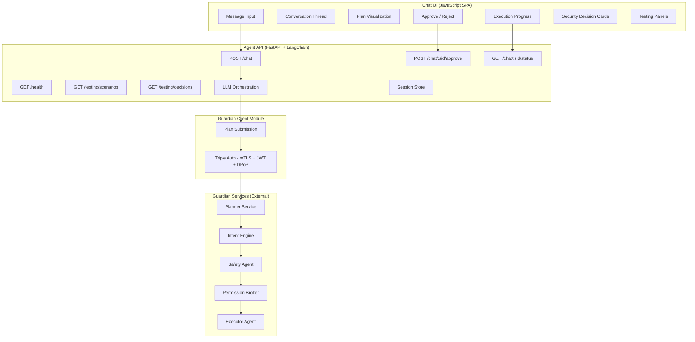
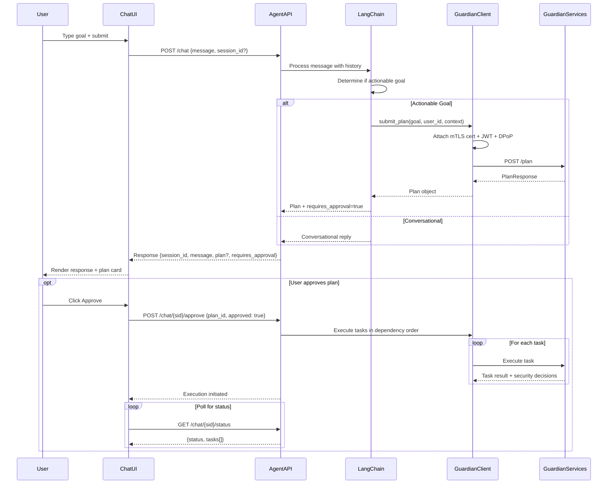
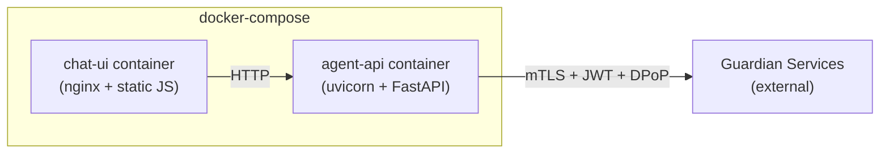

# Design Document: Guardian Agent UI

## Overview

The Guardian Agent UI is a standalone application that provides a conversational chat interface for interacting with the Zero-Trust Agentic Guardian services. It consists of three layers:

1. **Chat UI** — A JavaScript single-page application that renders a conversation thread, plan visualizations, approval controls, execution progress, and security decision cards.
2. **Agent API** — A Python FastAPI backend that receives user messages, uses an LLM orchestration framework (LangChain) to reason about user goals, manages sessions, and orchestrates calls to Guardian services.
3. **Guardian Client** — A self-contained HTTP client module within the Agent API that handles all communication with Guardian microservices using triple authentication (mTLS + JWT + DPoP).

The application is fully portable: zero imports from the Guardian codebase, its own Pydantic models mirroring the Guardian API contract, and communication exclusively through HTTP. It can be deployed as two containers (frontend + backend) via docker-compose and pointed at any compatible Guardian deployment.

### Key Design Decisions

- **LangChain over Agno**: LangChain is chosen as the LLM orchestration framework due to its mature tool-calling support, broad LLM provider compatibility, and well-documented patterns for agent workflows. The Guardian plan submission is exposed as a LangChain tool.
- **Polling over WebSockets**: The Chat UI polls the Agent API for execution status updates rather than using WebSockets. This simplifies deployment (no sticky sessions or WebSocket-aware load balancers) and is sufficient given the relatively low-frequency nature of plan execution updates (default 2-second interval).
- **In-memory session store**: Sessions are stored in-memory with TTL-based eviction. This keeps the application simple and avoids external dependencies. For production scaling, the session store interface can be swapped for Redis.
- **Testing Mode as a first-class feature**: Security testing capabilities (prompt injection panels, destructive action scenarios, security dashboard) are built into the application behind a `TESTING_MODE` environment variable, not bolted on as a separate tool.



## Architecture

### System Layers

The application follows a three-layer architecture with strict boundaries:

**Layer 1 — Chat UI (Browser)**
- Vanilla JavaScript SPA (or lightweight framework like Preact/Lit)
- Communicates with Agent API via `fetch()` calls
- Renders conversation thread, plan cards, approval buttons, progress indicators, security decision cards
- In Testing Mode: renders prompt injection panel, destructive action panel, security dashboard, decision log

**Layer 2 — Agent API (Server)**
- FastAPI application with LangChain agent
- Endpoints: `/chat`, `/chat/{session_id}/approve`, `/chat/{session_id}/status`, `/health`, `/testing/*`
- Session management with in-memory store + TTL eviction
- Structured JSON error responses with correlation IDs
- `X-Testing-Mode` header on all responses

**Layer 3 — Guardian Client (Module)**
- Self-contained Python module within the Agent API
- `httpx.AsyncClient` with mTLS certificate configuration
- JWT token acquisition and caching with automatic refresh
- DPoP proof generation per-request
- Own Pydantic models for all Guardian API schemas

### Request Flow



### Deployment



Both containers are defined in a single `docker-compose.yml`. The Chat UI is served by nginx as static files. The Agent API runs under uvicorn. Environment variables configure all external URLs and credentials.

## Components and Interfaces

### Chat UI Components

| Component | Responsibility |
|---|---|
| `MessageInput` | Text input + send button; disabled while awaiting approval |
| `ConversationThread` | Scrollable message list with auto-scroll |
| `MessageBubble` | Renders a single message (user or agent) with timestamp |
| `PlanCard` | Renders task graph, plan_id, status, dependency indicators |
| `ApprovalControls` | Approve/Reject buttons; shown when `requires_approval` is true |
| `ExecutionProgress` | Per-task status indicators; polls `/status` endpoint |
| `SecurityDecisionCard` | Expandable card showing decision outcome, reason, scores |
| `IntentScoreBar` | Color-coded bar for Intent_Misalignment_Score |
| `TestingPanel` | Prompt injection + destructive action scenario lists |
| `SecurityDashboard` | Running counts: total, blocked, allowed, block rate % |
| `DecisionLog` | Timestamped list of security decisions with detail links |
| `TestingModeBanner` | Visible banner when Testing Mode is active |

### Agent API Endpoints

| Endpoint | Method | Request Body | Response |
|---|---|---|---|
| `/chat` | POST | `{message, session_id?, context?}` | `{session_id, message, plan?, requires_approval, security_decisions?}` |
| `/chat/{session_id}/approve` | POST | `{plan_id, approved}` | `{session_id, status, message}` |
| `/chat/{session_id}/status` | GET | — | `{session_id, plan_id, status, tasks[]}` |
| `/health` | GET | — | `{status, version, dependencies}` |
| `/testing/scenarios` | GET | — | `{scenarios: {category: [...]}}` |
| `/testing/decisions` | GET | `?page=&page_size=` | `{decisions[], total, page, page_size}` |
| `/testing/decisions/{decision_id}` | GET | — | `{SecurityDecision full detail}` |

### Guardian Client Interface

```python
class GuardianClient:
    """Self-contained HTTP client for Guardian services."""

    async def submit_plan(
        self, user_goal: str, user_id: str, context: dict
    ) -> PlanResponse:
        """Submit a goal to the Guardian Planner. Handles triple auth."""
        ...

    async def execute_task(
        self, plan_id: str, task_id: str, action: str, provider: str
    ) -> TaskExecutionResult:
        """Execute a single task through the Guardian authorization chain."""
        ...

    async def check_health(self) -> dict:
        """Check connectivity to Guardian services."""
        ...
```

```python
class AuthManager:
    """Manages triple authentication credentials."""

    def get_mtls_config(self) -> tuple[str, str, str]:
        """Return (cert_path, key_path, ca_cert_path)."""
        ...

    async def get_jwt_token(self) -> str:
        """Get valid JWT token, refreshing if expired."""
        ...

    def generate_dpop_proof(
        self, access_token: str, method: str, url: str
    ) -> str:
        """Generate DPoP proof bound to the request."""
        ...
```

### Session Manager Interface

```python
class SessionManager:
    """In-memory session store with TTL eviction."""

    def create_session(self) -> AgentSession:
        """Create new session with UUID."""
        ...

    def get_session(self, session_id: str) -> AgentSession | None:
        """Get session, return None if expired/missing."""
        ...

    def update_session(self, session_id: str, session: AgentSession) -> None:
        """Update session and reset TTL."""
        ...

    def cleanup_expired(self) -> int:
        """Remove expired sessions, return count removed."""
        ...
```

## Data Models

### Agent API Models

```python
# --- Request Models ---

class ChatRequest(BaseModel):
    message: str = Field(..., min_length=1)
    session_id: str | None = None
    context: ChatContext | None = None

class ChatContext(BaseModel):
    role: str | None = None
    allowed_providers: list[str] | None = None

class ApprovalRequest(BaseModel):
    plan_id: str
    approved: bool

# --- Response Models ---

class ChatResponse(BaseModel):
    session_id: str
    message: str
    plan: PlanResponse | None = None
    requires_approval: bool = False
    security_decisions: list[SecurityDecision] | None = None

class StatusResponse(BaseModel):
    session_id: str
    plan_id: str | None = None
    status: Literal["idle", "awaiting_approval", "executing", "completed", "failed"]
    tasks: list[TaskStatus] = []

class TaskStatus(BaseModel):
    task_id: str
    status: Literal["pending", "running", "succeeded", "failed"]
    result: dict | None = None
    error: str | None = None

class HealthResponse(BaseModel):
    status: Literal["healthy", "degraded", "unhealthy"]
    version: str
    dependencies: dict[str, str]  # {"guardian": "reachable", "llm": "unreachable"}

class ErrorResponse(BaseModel):
    error: str  # error code
    message: str  # human-readable description

# --- Security Decision Models ---

class SecurityDecision(BaseModel):
    decision_id: str
    outcome: Literal["approved", "blocked"]
    reason_category: Literal[
        "intent_misalignment", "policy_violation", "auth_failure", "approved"
    ]
    details: SecurityDecisionDetails
    timestamp: str  # ISO 8601

class SecurityDecisionDetails(BaseModel):
    intent_misalignment_score: float | None = None
    intent_embedding_hash: str | None = None
    misaligned_actions: list[str] | None = None
    policy_rule_id: str | None = None
    policy_category: str | None = None
    violation_condition: str | None = None
    auth_chain_failure: Literal["mtls", "jwt", "dpop", "policy"] | None = None
    failure_reason: str | None = None
    intent_signature_result: dict | None = None
    policy_evaluation_trace: dict | None = None
    authorization_chain_result: dict | None = None
```

### Guardian Client Models (Standalone — No Guardian Imports)

```python
class PlanRequest(BaseModel):
    user_goal: str = Field(..., min_length=1)
    user_id: str
    context: dict = Field(default_factory=dict)

class PlanResponse(BaseModel):
    plan_id: str
    task_graph: list[TaskGraphItem]
    intent_signature: IntentSignature

class TaskGraphItem(BaseModel):
    task_id: str
    action: str
    provider: str
    dependencies: list[str] = Field(default_factory=list)

class IntentSignature(BaseModel):
    embedding: list[float]
    hash: str  # 64 hex chars (SHA256)
    allowed_actions: list[str]
    timestamp: str  # ISO 8601
    signature: str

    @field_validator("hash")
    @classmethod
    def validate_hash_format(cls, v):
        if len(v) != 64 or not all(c in "0123456789abcdef" for c in v.lower()):
            raise ValueError("Hash must be 64 hexadecimal characters")
        return v

    @field_validator("allowed_actions")
    @classmethod
    def validate_allowed_actions_non_empty(cls, v):
        if not v:
            raise ValueError("Allowed actions list cannot be empty")
        return v
```

### Session Model

```python
class AgentSession(BaseModel):
    session_id: str  # UUID
    created_at: datetime
    last_activity: datetime
    conversation_history: list[ConversationMessage] = []
    active_plan: PlanResponse | None = None
    plan_status: Literal[
        "idle", "awaiting_approval", "executing", "completed", "failed"
    ] = "idle"
    task_statuses: dict[str, TaskStatus] = {}
    security_decisions: list[SecurityDecision] = []

class ConversationMessage(BaseModel):
    role: Literal["user", "assistant"]
    content: str
    timestamp: datetime
    plan: PlanResponse | None = None
```

### Testing Mode Models

```python
class AttackScenario(BaseModel):
    scenario_id: str
    category: Literal[
        "prompt_injection", "destructive_action",
        "policy_violation", "authentication_bypass"
    ]
    name: str
    description: str
    payload: str
    expected_outcome: Literal["block", "flag", "allow"]

class TestingScenariosResponse(BaseModel):
    scenarios: dict[str, list[AttackScenario]]

class TestingDecisionsResponse(BaseModel):
    decisions: list[SecurityDecision]
    total: int
    page: int
    page_size: int
```


## Correctness Properties

*A property is a characteristic or behavior that should hold true across all valid executions of a system — essentially, a formal statement about what the system should do. Properties serve as the bridge between human-readable specifications and machine-verifiable correctness guarantees.*

### Property 1: PlanRequest serialization round-trip

*For any* valid `PlanRequest` object with an arbitrary `user_goal` string, `user_id` string, and `context` dict, serializing to JSON and deserializing back to a `PlanRequest` shall produce an equivalent object.

**Validates: Requirements 17.2**

### Property 2: PlanResponse serialization round-trip

*For any* valid `PlanResponse` object containing an arbitrary `plan_id`, a list of `TaskGraphItem` objects with valid `task_id`, `action`, `provider`, and `dependencies`, and a valid `IntentSignature`, serializing to JSON and deserializing back to a `PlanResponse` shall produce an equivalent object.

**Validates: Requirements 8.6, 17.3**

### Property 3: IntentSignature serialization round-trip

*For any* valid `IntentSignature` object with a 384-dimensional embedding vector, a 64-character hex hash, a non-empty allowed_actions list, a timestamp, and a signature string, serializing to JSON and deserializing back to an `IntentSignature` shall produce an equivalent object.

**Validates: Requirements 17.4**

### Property 4: Session ID uniqueness

*For any* number of sessions created (up to 10,000), all generated session IDs shall be unique and conform to UUID format.

**Validates: Requirements 12.1**

### Property 5: Session TTL eviction

*For any* session stored with a given TTL, after the TTL elapses without activity, the session shall no longer be retrievable from the store.

**Validates: Requirements 12.2, 12.3**

### Property 6: Session activity resets TTL

*For any* active session, receiving a request shall reset the inactivity timer such that the session remains retrievable for another full TTL period.

**Validates: Requirements 12.4**

### Property 7: New session creation on missing session_id

*For any* chat request sent without a `session_id`, the response shall contain a newly generated `session_id` that is a valid UUID and that can be used in subsequent requests.

**Validates: Requirements 6.2**

### Property 8: Invalid session returns 404

*For any* request (to `/chat`, `/chat/{session_id}/approve`, or `/chat/{session_id}/status`) with a `session_id` that does not exist in the session store, the API shall return an HTTP 404 response with a JSON body containing `error` and `message` fields.

**Validates: Requirements 6.5, 10.5, 11.4**

### Property 9: Chat response schema validity

*For any* valid `ChatRequest`, the `/chat` endpoint response shall be a valid `ChatResponse` containing `session_id` (string), `message` (string), `plan` (nullable object), and `requires_approval` (boolean).

**Validates: Requirements 6.1, 6.4**

### Property 10: Plan storage triggers approval requirement

*For any* chat request that results in the Guardian Client returning a Plan, the response shall have `requires_approval` set to `true` and the session shall contain the plan.

**Validates: Requirements 10.1**

### Property 11: Task execution respects dependency order

*For any* task graph where task B depends on task A, task A shall complete execution before task B begins execution.

**Validates: Requirements 10.3**

### Property 12: Plan rejection updates session state

*For any* session with an active plan, sending a rejection (approved=false) shall mark the plan as rejected and the session status shall no longer be "awaiting_approval".

**Validates: Requirements 10.4**

### Property 13: Status response schema validity

*For any* valid session, the `/chat/{session_id}/status` endpoint shall return a response containing `session_id`, `plan_id` (nullable), `status` (one of: idle, awaiting_approval, executing, completed, failed), and `tasks` (array of task status objects).

**Validates: Requirements 11.2**

### Property 14: Task completion updates session

*For any* task that completes execution (success or failure), the corresponding task status in the session shall be updated to "succeeded" or "failed" with the appropriate result or error data.

**Validates: Requirements 11.3**

### Property 15: Triple authentication on all Guardian requests

*For any* HTTP request sent by the Guardian Client to Guardian Services, the request shall include: (a) a client TLS certificate for mTLS, (b) an `Authorization` header with a Bearer JWT token, and (c) a `DPoP` header with a proof bound to the request's HTTP method and URL.

**Validates: Requirements 8.4, 9.1, 9.2, 9.3**

### Property 16: DPoP proof freshness

*For any* DPoP proof generated by the Guardian Client, the `iat` timestamp shall be within the configured freshness window (default 60 seconds) of the current time.

**Validates: Requirements 9.6**

### Property 17: Guardian Client error mapping

*For any* HTTP error response (4xx or 5xx) from the Guardian `/plan` endpoint, the Guardian Client shall raise a typed exception containing the HTTP status code and error details from the response body.

**Validates: Requirements 8.3**

### Property 18: Missing environment variable prevents startup

*For any* required environment variable (`GUARDIAN_PLANNER_URL`, `LLM_API_KEY`, `MTLS_CERT_PATH`, `MTLS_KEY_PATH`, `MTLS_CA_CERT_PATH`, `AUTH0_DOMAIN`, `AUTH0_CLIENT_ID`, `AUTH0_CLIENT_SECRET`) that is absent, the application shall fail to start with a non-zero exit code and a log message identifying the missing variable.

**Validates: Requirements 13.5**

### Property 19: Consistent error response format

*For any* error response from the Agent API (4xx or 5xx), the response body shall be valid JSON containing an `error` string (error code) and a `message` string (human-readable description).

**Validates: Requirements 14.1, 14.4**

### Property 20: Health endpoint degradation detection

*For any* combination of unreachable dependencies (Guardian Services, LLM provider), the `/health` endpoint shall return `status` as "degraded" and the `dependencies` object shall identify each unreachable dependency.

**Validates: Requirements 15.4**

### Property 21: Security decisions included in Guardian-evaluated responses

*For any* `/chat` request that triggers Guardian evaluation, the response shall include a `security_decisions` array where each entry contains `decision_id`, `outcome` (approved or blocked), `reason_category`, `details`, and `timestamp`. When the outcome is "blocked" due to intent misalignment, `details` shall include `intent_misalignment_score`. When blocked due to policy violation, `details` shall include `policy_rule_id`. When blocked due to auth failure, `details` shall include `auth_chain_failure` identifying which link failed.

**Validates: Requirements 18.6, 19.3, 19.6, 21.5**

### Property 22: Testing endpoints return 404 when disabled

*For any* request to `/testing/scenarios`, `/testing/decisions`, or `/testing/decisions/{id}` when `TESTING_MODE` is "disabled", the Agent API shall return an HTTP 404 response.

**Validates: Requirements 20.7**

### Property 23: X-Testing-Mode header on all responses

*For any* response from the Agent API, the response shall include an `X-Testing-Mode` header with value "enabled" or "disabled" matching the current configuration.

**Validates: Requirements 20.8**

### Property 24: Testing decisions pagination

*For any* page number and page size, the `/testing/decisions` endpoint shall return at most `page_size` decisions, a correct `total` count, and the results shall be ordered by timestamp descending.

**Validates: Requirements 20.3**

### Property 25: Intent misalignment score color coding

*For any* `Intent_Misalignment_Score` value, the visual indicator shall be green for scores above 0.8, yellow for scores between 0.7 and 0.8 (inclusive), and red for scores below 0.7.

**Validates: Requirements 21.2**

### Property 26: Conversation message chronological ordering

*For any* sequence of messages added to a conversation, the displayed order shall match chronological order (earliest first).

**Validates: Requirements 2.1**

### Property 27: Plan rendering contains required fields

*For any* valid plan with one or more tasks, the rendered plan visualization shall contain the `plan_id` and for each task shall display the `action`, `provider`, and `dependencies`.

**Validates: Requirements 3.1, 3.2**

### Property 28: Conversation history preserved across requests

*For any* session with existing conversation history, sending a new message shall result in the LLM context including all previous messages from that session.

**Validates: Requirements 6.3**

### Property 29: Guardian Client request body correctness

*For any* plan submission, the HTTP POST request body sent to the Guardian `/plan` endpoint shall contain `user_goal` (string), `user_id` (string), and `context` (object with `role` and `allowed_providers` fields) matching the input parameters.

**Validates: Requirements 8.1, 8.2**

## Error Handling

### Agent API Error Strategy

All errors follow a consistent pattern using the `ErrorResponse` model:

```python
class ErrorResponse(BaseModel):
    error: str    # machine-readable error code
    message: str  # human-readable description
```

| Scenario | HTTP Status | Error Code | Description |
|---|---|---|---|
| Invalid request body | 422 | `validation_error` | Pydantic validation failure details |
| Session not found / expired | 404 | `session_not_found` | Session ID does not exist or has expired |
| Plan not found in session | 404 | `plan_not_found` | No active plan for the given plan_id |
| Guardian services unreachable | 502 | `guardian_unavailable` | Cannot connect to Guardian Planner/Safety Agent |
| LLM provider unreachable | 502 | `llm_unavailable` | Cannot connect to LLM API |
| Guardian returns error | 502 | `guardian_error` | Guardian returned a non-2xx response |
| Internal server error | 500 | `internal_error` | Unexpected error |
| Testing endpoints when disabled | 404 | `not_found` | Testing mode is not enabled |

### Guardian Client Error Handling

The Guardian Client raises typed exceptions that the Agent API catches and maps to HTTP responses:

```python
class GuardianClientError(Exception):
    """Base exception for Guardian Client errors."""
    status_code: int
    details: dict

class GuardianConnectionError(GuardianClientError):
    """Cannot connect to Guardian services."""

class GuardianAuthenticationError(GuardianClientError):
    """Triple authentication failed."""

class GuardianPlanError(GuardianClientError):
    """Guardian returned an error for plan submission."""
```

### Structured Logging

All errors are logged with structured JSON including:
- `correlation_id`: UUID generated per-request via middleware
- `timestamp`: ISO 8601
- `error_type`: Exception class name
- `stack_trace`: Full traceback
- `session_id`: If available
- `endpoint`: Request path

### Chat UI Error Display

The Chat UI renders errors as message bubbles in the conversation thread with a distinct error styling. Error messages are derived from the `message` field of the `ErrorResponse`. Network errors (fetch failures) display a generic "Unable to reach the agent. Please try again." message.

## Testing Strategy

### Dual Testing Approach

The testing strategy uses both unit tests and property-based tests:

- **Property-based tests** verify universal properties across randomly generated inputs (minimum 100 iterations per test). They cover serialization round-trips, session management invariants, API schema contracts, authentication correctness, and error handling consistency.
- **Unit tests** verify specific examples, edge cases, integration points, and scenarios that depend on specific values (e.g., a particular HTTP status code, a specific UI element being rendered).

### Property-Based Testing Configuration

- **Library**: [Hypothesis](https://hypothesis.readthedocs.io/) for Python (Agent API + Guardian Client)
- **Library**: [fast-check](https://fast-check.dev/) for JavaScript (Chat UI)
- **Minimum iterations**: 100 per property test (`@settings(max_examples=100)` for Hypothesis, `fc.assert(..., { numRuns: 100 })` for fast-check)
- **Tagging**: Each property test includes a comment referencing the design property:
  ```python
  # Feature: guardian-agent-ui, Property 1: PlanRequest serialization round-trip
  ```
- **Each correctness property is implemented by a single property-based test.**

### Test Organization

```
tests/
├── property/
│   ├── test_schema_roundtrip.py        # Properties 1-3
│   ├── test_session_management.py      # Properties 4-7
│   ├── test_api_contracts.py           # Properties 8-14, 28-29
│   ├── test_guardian_client.py         # Properties 15-17
│   ├── test_configuration.py           # Property 18
│   ├── test_error_handling.py          # Property 19
│   ├── test_health.py                  # Property 20
│   ├── test_security_decisions.py      # Property 21
│   ├── test_testing_mode.py            # Properties 22-24
│   └── test_ui_properties.py           # Properties 25-27
├── unit/
│   ├── test_chat_endpoint.py           # Specific examples for /chat
│   ├── test_approval_flow.py           # Approve/reject scenarios
│   ├── test_status_endpoint.py         # Status polling scenarios
│   ├── test_guardian_client_unit.py     # Token refresh, specific errors
│   ├── test_testing_mode_unit.py       # Scenario loading, decision detail
│   ├── test_health_unit.py             # Specific health check scenarios
│   └── test_config_unit.py             # Specific env var scenarios
├── ui/
│   ├── test_message_input.js           # Input field + send button
│   ├── test_conversation_thread.js     # Message rendering, scrolling
│   ├── test_plan_card.js               # Plan visualization
│   ├── test_approval_controls.js       # Approve/reject buttons
│   ├── test_execution_progress.js      # Polling + status updates
│   ├── test_security_decision_card.js  # Decision cards, score bars
│   └── test_testing_panels.js          # Testing mode UI components
└── integration/
    ├── test_chat_flow.py               # Full chat → plan → approve → execute
    └── test_testing_mode_flow.py        # Testing mode end-to-end
```

### Key Testing Decisions

- **Guardian Client tests use `httpx` mock transport** to simulate Guardian responses without network calls.
- **Agent API tests use FastAPI `TestClient`** for endpoint testing with mocked LangChain and Guardian Client.
- **Session TTL tests use time mocking** (e.g., `freezegun`) to simulate time passage without real delays.
- **Chat UI tests use a lightweight DOM testing library** (e.g., Testing Library) with fast-check for property tests.
- **LLM behavior is not property-tested** because it is non-deterministic. LLM integration is tested via unit tests with mocked responses.
