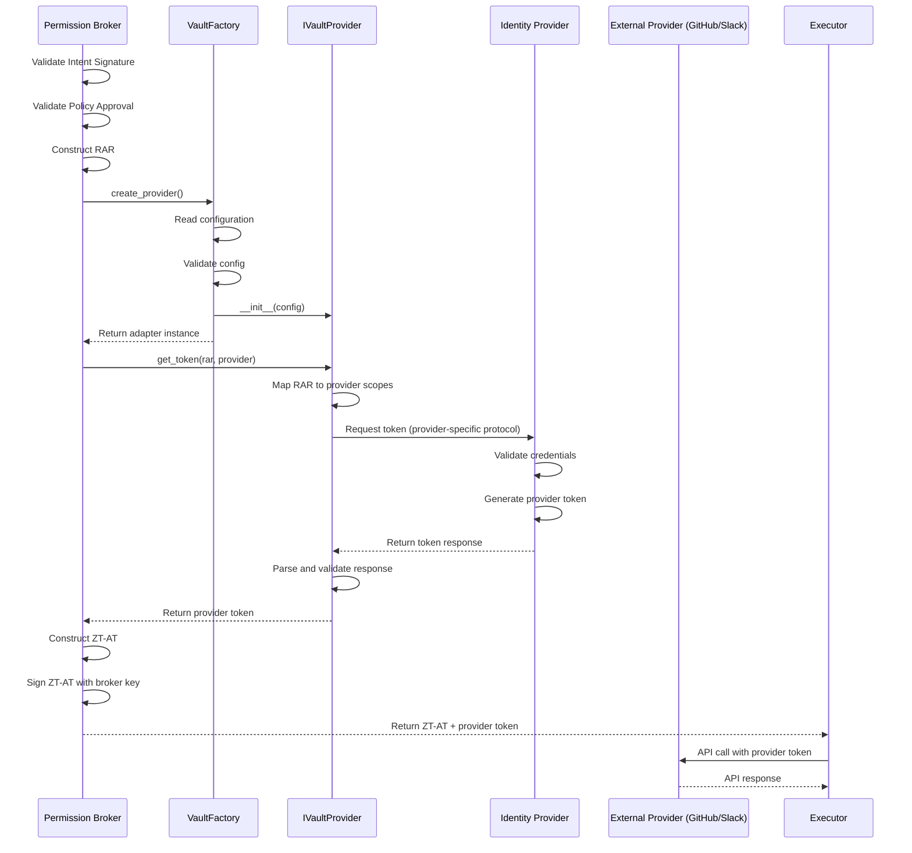
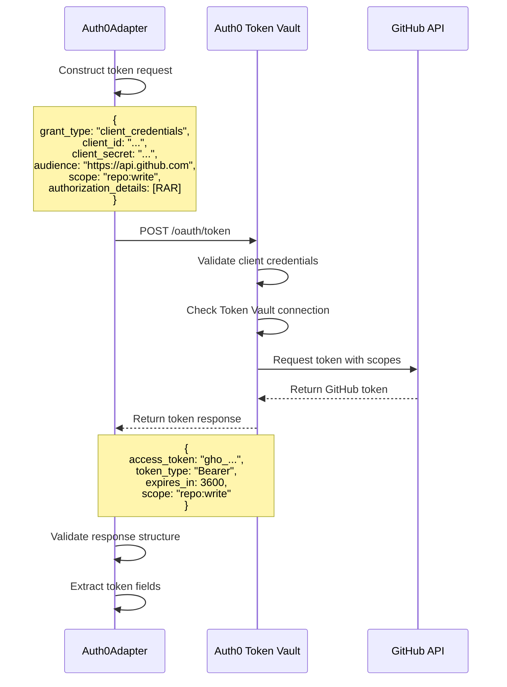
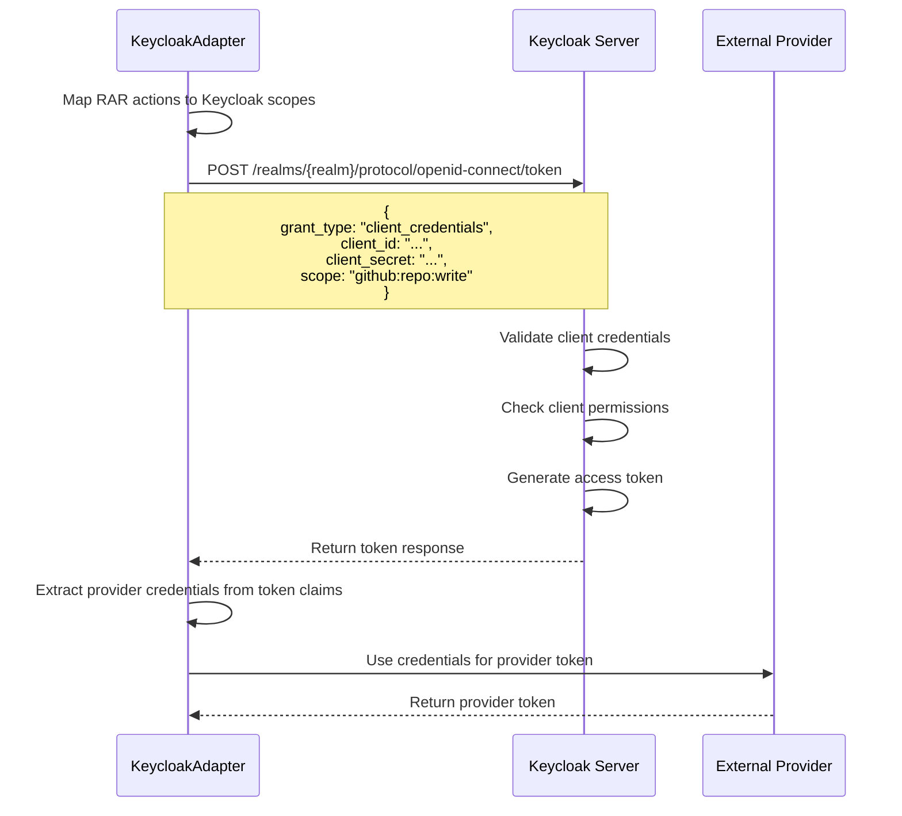
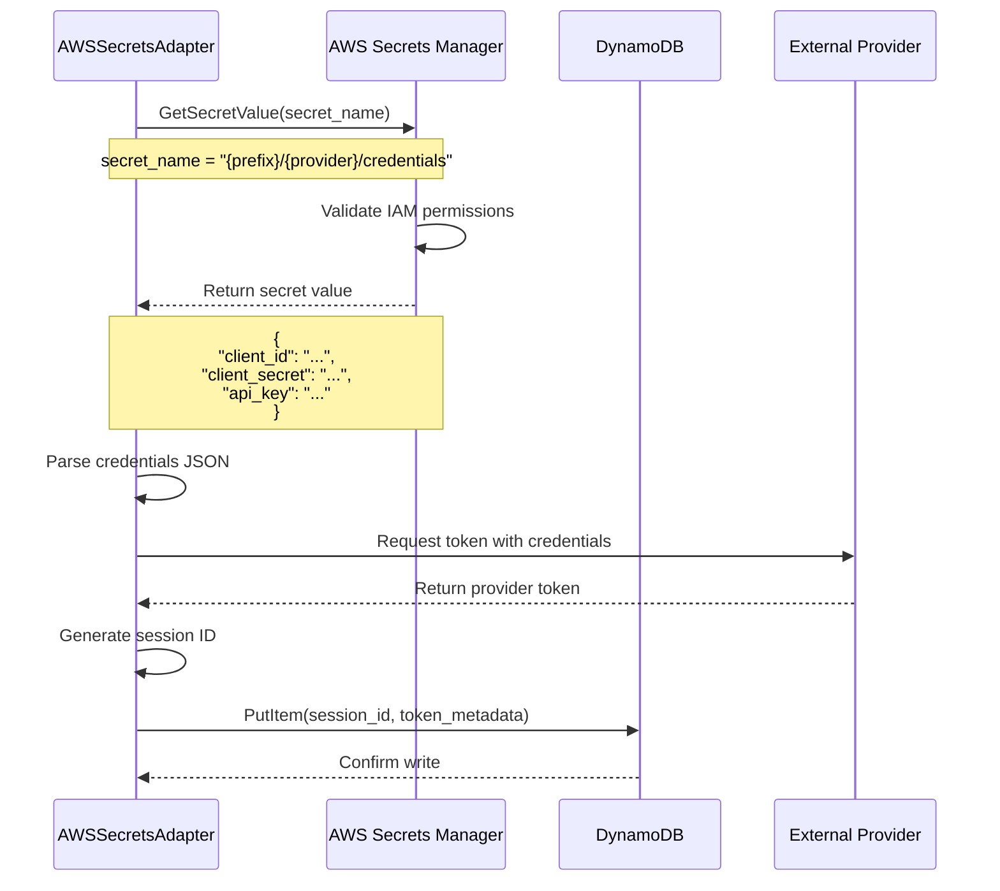

# Design Document: Identity Abstraction Layer

## Overview

The Identity Abstraction Layer (IAL) decouples the Zero-Trust Agentic Guardian system from specific Identity Provider (IdP) implementations. Currently, the Permission Broker's TokenVaultClient is tightly coupled to Auth0's Token Vault API, creating vendor lock-in and preventing organizations from using alternative identity providers like Keycloak or AWS Secrets Manager.

The IAL introduces a provider-agnostic interface (IVaultProvider) with concrete adapter implementations for each supported identity provider. This design follows the Adapter pattern, allowing the system to function as Identity-Agnostic Middleware where the choice of identity provider becomes a configuration decision rather than a code change.

The abstraction layer maintains complete backward compatibility with existing Auth0 integrations while enabling future extensibility. The Permission Broker interacts exclusively with the IVaultProvider interface, remaining unaware of the underlying provider implementation. A VaultFactory instantiates the appropriate adapter at runtime based on system configuration.

Key design principles:
- Interface segregation: Single responsibility for token operations
- Dependency inversion: Permission Broker depends on abstraction, not concrete implementations
- Open/closed principle: Open for extension (new adapters), closed for modification (core logic)
- Backward compatibility: Existing Auth0 deployments continue working without changes
- Configuration-driven: Provider selection through declarative configuration
- Consistent error handling: Unified exception hierarchy across all adapters

The IAL integrates seamlessly into the existing Zero-Trust authorization flow:
1. Permission Broker validates authorization chain (Intent Signature + Policy Approval)
2. Permission Broker constructs Rich Authorization Request (RAR)
3. VaultFactory provides configured IVaultProvider adapter
4. Adapter retrieves provider token using provider-specific protocol
5. Permission Broker constructs Zero-Trust Authorization Token (ZT-AT)
6. Executor Agent uses provider token for API calls


## Architecture

### High-Level System Integration

The IAL sits between the Permission Broker and external identity providers, acting as an abstraction boundary:

```
┌─────────────────────────────────────────────────────────────────┐
│                    Zero-Trust Agentic Guardian                   │
│                                                                   │
│  ┌──────────┐    ┌────────────┐    ┌──────────────────────┐    │
│  │ Planner  │───▶│   Safety   │───▶│  Permission Broker   │    │
│  │ Service  │    │   Agent    │    │                      │    │
│  └──────────┘    └────────────┘    │  ┌────────────────┐  │    │
│                                     │  │ VaultFactory   │  │    │
│                                     │  └────────┬───────┘  │    │
│                                     │           │          │    │
│                                     │           ▼          │    │
│                                     │  ┌────────────────┐  │    │
│                                     │  │ IVaultProvider │  │    │
│                                     │  │   Interface    │  │    │
│                                     │  └────────┬───────┘  │    │
│                                     └───────────┼──────────┘    │
│                                                 │                │
└─────────────────────────────────────────────────┼────────────────┘
                                                  │
                    ┌─────────────────────────────┼─────────────────────────┐
                    │                             │                         │
                    ▼                             ▼                         ▼
          ┌──────────────────┐        ┌──────────────────┐      ┌──────────────────┐
          │  Auth0Adapter    │        │ KeycloakAdapter  │      │ AWSSecretsAdapter│
          │                  │        │                  │      │                  │
          │ - Token Vault    │        │ - Client Creds   │      │ - Secrets Mgr    │
          │ - RAR Support    │        │ - Token Exchange │      │ - DynamoDB       │
          └────────┬─────────┘        └────────┬─────────┘      └────────┬─────────┘
                   │                           │                         │
                   ▼                           ▼                         ▼
          ┌──────────────────┐        ┌──────────────────┐      ┌──────────────────┐
          │   Auth0 Cloud    │        │   Keycloak       │      │   AWS Services   │
          │   Token Vault    │        │   Server         │      │   Secrets Mgr    │
          └──────────────────┘        └──────────────────┘      └──────────────────┘
```

### Component Relationships


**IVaultProvider Interface**: Abstract base class defining the contract for all identity provider adapters. Declares five methods: get_token, exchange_token, revoke_session, health_check, and get_provider_name.

**Auth0Adapter**: Refactored implementation of the existing TokenVaultClient. Implements IVaultProvider interface while preserving all existing functionality including Auth0 Token Vault integration, RAR construction, and timeout handling.

**KeycloakAdapter**: New implementation for Keycloak identity provider. Uses Keycloak's client credentials flow and token exchange protocol. Supports realm-based multi-tenancy and configurable scope mapping.

**AWSSecretsAdapter**: New implementation for AWS Secrets Manager. Retrieves provider credentials from Secrets Manager, generates tokens, and tracks session revocation in DynamoDB. Supports IAM role-based authentication.

**VaultFactory**: Factory class that reads configuration and instantiates the appropriate adapter. Validates configuration completeness before instantiation. Provides singleton pattern to ensure single adapter instance per application lifecycle.

**Permission Broker Integration**: The Permission Broker replaces direct TokenVaultClient instantiation with VaultFactory.create_provider(). All token operations go through the IVaultProvider interface, maintaining complete decoupling from concrete implementations.

### Token Request Flow Sequence




### Auth0 Adapter Flow




### Keycloak Adapter Flow



### AWS Secrets Manager Adapter Flow




## Components and Interfaces

### IVaultProvider Interface

Abstract base class defining the contract for all identity provider adapters.

```python
from abc import ABC, abstractmethod
from typing import Dict, Any
from shared.schemas import RichAuthorizationRequest


class IVaultProvider(ABC):
    """Abstract interface for identity provider adapters.
    
    All concrete adapters must implement this interface to ensure
    consistent behavior across different identity providers.
    """
    
    @abstractmethod
    async def get_token(
        self,
        rar: RichAuthorizationRequest,
        provider: str
    ) -> Dict[str, Any]:
        """Request a provider-specific token.
        
        Args:
            rar: Rich Authorization Request containing action details
            provider: Target provider (github, slack, google_workspace)
            
        Returns:
            Dictionary with token information:
            - access_token: Provider access token
            - token_type: Token type (usually "Bearer")
            - expires_in: Token expiration in seconds
            - scope: Granted scopes
            
        Raises:
            VaultProviderError: Network or provider errors
            VaultAuthenticationError: Invalid credentials
            VaultValidationError: Invalid RAR or response
            VaultTimeoutError: Request timeout
        """
        pass
    
    @abstractmethod
    async def exchange_token(
        self,
        existing_token: str,
        new_scopes: list[str],
        provider: str
    ) -> Dict[str, Any]:
        """Exchange an existing token for a new token with different scopes.
        
        Args:
            existing_token: Current access token
            new_scopes: Requested scopes for new token
            provider: Target provider
            
        Returns:
            Dictionary with new token information
            
        Raises:
            VaultProviderError: Exchange failed
            VaultAuthenticationError: Invalid token
        """
        pass
    
    @abstractmethod
    async def revoke_session(self, session_id: str) -> bool:
        """Revoke an active session.
        
        Args:
            session_id: Unique session identifier
            
        Returns:
            True if revocation succeeded, False otherwise
            
        Raises:
            VaultProviderError: Revocation failed
        """
        pass
    
    @abstractmethod
    async def health_check(self) -> bool:
        """Check if the identity provider is accessible.
        
        Returns:
            True if provider is healthy, False otherwise
        """
        pass
    
    @abstractmethod
    def get_provider_name(self) -> str:
        """Get the identity provider type.
        
        Returns:
            Provider name (auth0, keycloak, aws_secrets)
        """
        pass
```

### Auth0Adapter Implementation


Refactored implementation of TokenVaultClient implementing IVaultProvider interface.

```python
import httpx
from typing import Dict, Any
from .ivault_provider import IVaultProvider
from .exceptions import VaultProviderError, VaultAuthenticationError, VaultTimeoutError
from shared.schemas import RichAuthorizationRequest
from shared.logging import JSONLogger


logger = JSONLogger(__name__)


class Auth0Adapter(IVaultProvider):
    """Auth0 Token Vault adapter implementation."""
    
    def __init__(self, config: Dict[str, Any]):
        """Initialize Auth0 adapter.
        
        Args:
            config: Configuration dictionary with keys:
                - domain: Auth0 domain
                - client_id: M2M application client ID
                - client_secret: M2M application client secret
                - token_vault_url: Optional custom Token Vault URL
                - timeout: Optional request timeout (default: 10.0)
        """
        self.domain = config["domain"]
        self.client_id = config["client_id"]
        self.client_secret = config["client_secret"]
        self.token_vault_url = config.get("token_vault_url") or f"https://{self.domain}/oauth/token"
        self.timeout = config.get("timeout", 10.0)
        
        logger.info(f"Initialized Auth0Adapter for domain: {self.domain}")
    
    async def get_token(
        self,
        rar: RichAuthorizationRequest,
        provider: str
    ) -> Dict[str, Any]:
        """Request provider token from Auth0 Token Vault."""
        logger.info(f"Requesting token for provider: {provider}")
        
        # Construct token request with RAR
        token_request = {
            "grant_type": "client_credentials",
            "client_id": self.client_id,
            "client_secret": self.client_secret,
            "audience": self._get_provider_audience(provider),
            "scope": " ".join(rar.actions),
            "authorization_details": [
                {
                    "type": rar.type,
                    "actions": rar.actions,
                    "locations": rar.locations,
                    "purpose": rar.purpose,
                    "context": rar.context
                }
            ]
        }
        
        try:
            async with httpx.AsyncClient(timeout=self.timeout) as client:
                response = await client.post(
                    self.token_vault_url,
                    json=token_request,
                    headers={"Content-Type": "application/json"}
                )
                
                if response.status_code == 401:
                    raise VaultAuthenticationError("Auth0 authentication failed")
                
                if response.status_code != 200:
                    error_detail = response.json() if response.text else {}
                    raise VaultProviderError(
                        f"Auth0 returned {response.status_code}: "
                        f"{error_detail.get('error_description', 'Unknown error')}"
                    )
                
                token_data = response.json()
                
                return {
                    "access_token": token_data["access_token"],
                    "token_type": token_data.get("token_type", "Bearer"),
                    "expires_in": token_data.get("expires_in", 3600),
                    "scope": token_data.get("scope", " ".join(rar.actions))
                }
        
        except httpx.TimeoutException:
            raise VaultTimeoutError("Auth0 request timed out")
        except httpx.RequestError as e:
            raise VaultProviderError(f"Auth0 request failed: {str(e)}")
    
    async def exchange_token(
        self,
        existing_token: str,
        new_scopes: list[str],
        provider: str
    ) -> Dict[str, Any]:
        """Exchange token using Auth0 token exchange."""
        exchange_request = {
            "grant_type": "urn:ietf:params:oauth:grant-type:token-exchange",
            "client_id": self.client_id,
            "client_secret": self.client_secret,
            "subject_token": existing_token,
            "subject_token_type": "urn:ietf:params:oauth:token-type:access_token",
            "scope": " ".join(new_scopes)
        }
        
        try:
            async with httpx.AsyncClient(timeout=self.timeout) as client:
                response = await client.post(
                    self.token_vault_url,
                    json=exchange_request
                )
                
                if response.status_code != 200:
                    raise VaultProviderError(f"Token exchange failed: {response.status_code}")
                
                return response.json()
        
        except httpx.TimeoutException:
            raise VaultTimeoutError("Token exchange timed out")
    
    async def revoke_session(self, session_id: str) -> bool:
        """Revoke session using Auth0 revocation endpoint."""
        revoke_url = f"https://{self.domain}/oauth/revoke"
        
        try:
            async with httpx.AsyncClient(timeout=self.timeout) as client:
                response = await client.post(
                    revoke_url,
                    json={
                        "client_id": self.client_id,
                        "client_secret": self.client_secret,
                        "token": session_id
                    }
                )
                
                return response.status_code == 200
        
        except Exception as e:
            logger.error(f"Session revocation failed: {str(e)}")
            return False
    
    async def health_check(self) -> bool:
        """Check Auth0 availability."""
        try:
            async with httpx.AsyncClient(timeout=5.0) as client:
                response = await client.get(
                    f"https://{self.domain}/.well-known/openid-configuration"
                )
                return response.status_code == 200
        except Exception:
            return False
    
    def get_provider_name(self) -> str:
        """Return provider name."""
        return "auth0"
    
    def _get_provider_audience(self, provider: str) -> str:
        """Map provider to OAuth audience."""
        audiences = {
            "github": "https://api.github.com",
            "slack": "https://slack.com/api",
            "google_workspace": "https://www.googleapis.com"
        }
        return audiences.get(provider, f"https://{provider}.com/api")
```

### KeycloakAdapter Implementation


New implementation for Keycloak identity provider.

```python
import httpx
from typing import Dict, Any
from .ivault_provider import IVaultProvider
from .exceptions import VaultProviderError, VaultAuthenticationError, VaultTimeoutError
from shared.schemas import RichAuthorizationRequest
from shared.logging import JSONLogger


logger = JSONLogger(__name__)


class KeycloakAdapter(IVaultProvider):
    """Keycloak identity provider adapter implementation."""
    
    def __init__(self, config: Dict[str, Any]):
        """Initialize Keycloak adapter.
        
        Args:
            config: Configuration dictionary with keys:
                - server_url: Keycloak server URL
                - realm: Keycloak realm name
                - client_id: Client ID
                - client_secret: Client secret
                - scope_mapping: Dict mapping RAR actions to Keycloak scopes
                - timeout: Optional request timeout (default: 10.0)
        """
        self.server_url = config["server_url"].rstrip("/")
        self.realm = config["realm"]
        self.client_id = config["client_id"]
        self.client_secret = config["client_secret"]
        self.scope_mapping = config.get("scope_mapping", {})
        self.timeout = config.get("timeout", 10.0)
        
        self.token_url = f"{self.server_url}/realms/{self.realm}/protocol/openid-connect/token"
        
        logger.info(f"Initialized KeycloakAdapter for realm: {self.realm}")
    
    async def get_token(
        self,
        rar: RichAuthorizationRequest,
        provider: str
    ) -> Dict[str, Any]:
        """Request provider token from Keycloak."""
        logger.info(f"Requesting token for provider: {provider}")
        
        # Map RAR actions to Keycloak scopes
        keycloak_scopes = self._map_scopes(rar.actions, provider)
        
        # Construct token request
        token_request = {
            "grant_type": "client_credentials",
            "client_id": self.client_id,
            "client_secret": self.client_secret,
            "scope": " ".join(keycloak_scopes)
        }
        
        try:
            async with httpx.AsyncClient(timeout=self.timeout) as client:
                response = await client.post(
                    self.token_url,
                    data=token_request,
                    headers={"Content-Type": "application/x-www-form-urlencoded"}
                )
                
                if response.status_code == 401:
                    raise VaultAuthenticationError("Keycloak authentication failed")
                
                if response.status_code != 200:
                    error_detail = response.json() if response.text else {}
                    raise VaultProviderError(
                        f"Keycloak returned {response.status_code}: "
                        f"{error_detail.get('error_description', 'Unknown error')}"
                    )
                
                token_data = response.json()
                
                return {
                    "access_token": token_data["access_token"],
                    "token_type": token_data.get("token_type", "Bearer"),
                    "expires_in": token_data.get("expires_in", 3600),
                    "scope": token_data.get("scope", " ".join(keycloak_scopes))
                }
        
        except httpx.TimeoutException:
            raise VaultTimeoutError("Keycloak request timed out")
        except httpx.RequestError as e:
            raise VaultProviderError(f"Keycloak request failed: {str(e)}")
    
    async def exchange_token(
        self,
        existing_token: str,
        new_scopes: list[str],
        provider: str
    ) -> Dict[str, Any]:
        """Exchange token using Keycloak token exchange."""
        keycloak_scopes = self._map_scopes(new_scopes, provider)
        
        exchange_request = {
            "grant_type": "urn:ietf:params:oauth:grant-type:token-exchange",
            "client_id": self.client_id,
            "client_secret": self.client_secret,
            "subject_token": existing_token,
            "requested_token_type": "urn:ietf:params:oauth:token-type:access_token",
            "scope": " ".join(keycloak_scopes)
        }
        
        try:
            async with httpx.AsyncClient(timeout=self.timeout) as client:
                response = await client.post(
                    self.token_url,
                    data=exchange_request,
                    headers={"Content-Type": "application/x-www-form-urlencoded"}
                )
                
                if response.status_code != 200:
                    raise VaultProviderError(f"Token exchange failed: {response.status_code}")
                
                return response.json()
        
        except httpx.TimeoutException:
            raise VaultTimeoutError("Token exchange timed out")
    
    async def revoke_session(self, session_id: str) -> bool:
        """Revoke session using Keycloak logout endpoint."""
        logout_url = f"{self.server_url}/realms/{self.realm}/protocol/openid-connect/logout"
        
        try:
            async with httpx.AsyncClient(timeout=self.timeout) as client:
                response = await client.post(
                    logout_url,
                    data={
                        "client_id": self.client_id,
                        "client_secret": self.client_secret,
                        "refresh_token": session_id
                    },
                    headers={"Content-Type": "application/x-www-form-urlencoded"}
                )
                
                return response.status_code == 204
        
        except Exception as e:
            logger.error(f"Session revocation failed: {str(e)}")
            return False
    
    async def health_check(self) -> bool:
        """Check Keycloak availability."""
        try:
            async with httpx.AsyncClient(timeout=5.0) as client:
                response = await client.get(
                    f"{self.server_url}/realms/{self.realm}"
                )
                return response.status_code == 200
        except Exception:
            return False
    
    def get_provider_name(self) -> str:
        """Return provider name."""
        return "keycloak"
    
    def _map_scopes(self, rar_actions: list[str], provider: str) -> list[str]:
        """Map RAR actions to Keycloak scopes using configured mapping."""
        keycloak_scopes = []
        
        for action in rar_actions:
            # Check if there's a specific mapping for this action
            mapped_scope = self.scope_mapping.get(action)
            
            if mapped_scope:
                # Support multiple scopes per action
                if isinstance(mapped_scope, list):
                    keycloak_scopes.extend(mapped_scope)
                else:
                    keycloak_scopes.append(mapped_scope)
            else:
                # Default: use provider:action format
                keycloak_scopes.append(f"{provider}:{action}")
        
        return keycloak_scopes
```

### AWSSecretsAdapter Implementation


New implementation for AWS Secrets Manager credential storage.

```python
import json
import boto3
from typing import Dict, Any
from datetime import datetime, timedelta
from .ivault_provider import IVaultProvider
from .exceptions import VaultProviderError, VaultAuthenticationError, VaultTimeoutError
from shared.schemas import RichAuthorizationRequest
from shared.logging import JSONLogger


logger = JSONLogger(__name__)


class AWSSecretsAdapter(IVaultProvider):
    """AWS Secrets Manager adapter implementation."""
    
    def __init__(self, config: Dict[str, Any]):
        """Initialize AWS Secrets Manager adapter.
        
        Args:
            config: Configuration dictionary with keys:
                - region: AWS region
                - secret_name_prefix: Prefix for secret names
                - session_table_name: DynamoDB table for session tracking
                - timeout: Optional request timeout (default: 10.0)
        """
        self.region = config["region"]
        self.secret_name_prefix = config["secret_name_prefix"]
        self.session_table_name = config["session_table_name"]
        self.timeout = config.get("timeout", 10.0)
        
        # Initialize AWS clients
        self.secrets_client = boto3.client(
            'secretsmanager',
            region_name=self.region
        )
        self.dynamodb = boto3.resource(
            'dynamodb',
            region_name=self.region
        )
        self.session_table = self.dynamodb.Table(self.session_table_name)
        
        logger.info(f"Initialized AWSSecretsAdapter for region: {self.region}")
    
    async def get_token(
        self,
        rar: RichAuthorizationRequest,
        provider: str
    ) -> Dict[str, Any]:
        """Request provider token using credentials from AWS Secrets Manager."""
        logger.info(f"Requesting token for provider: {provider}")
        
        # Retrieve provider credentials from Secrets Manager
        secret_name = f"{self.secret_name_prefix}/{provider}/credentials"
        
        try:
            response = self.secrets_client.get_secret_value(SecretId=secret_name)
            credentials = json.loads(response['SecretString'])
            
            # Generate provider token using retrieved credentials
            # This is a simplified implementation - actual implementation would
            # use provider-specific OAuth flows
            token = {
                "access_token": credentials.get("access_token") or self._generate_token(credentials, provider),
                "token_type": "Bearer",
                "expires_in": 3600,
                "scope": " ".join(rar.actions)
            }
            
            # Track session in DynamoDB
            session_id = self._generate_session_id()
            self._store_session(session_id, provider, token)
            
            return token
        
        except self.secrets_client.exceptions.ResourceNotFoundException:
            raise VaultProviderError(f"Secret not found: {secret_name}")
        except self.secrets_client.exceptions.InvalidRequestException:
            raise VaultAuthenticationError("Invalid AWS credentials")
        except Exception as e:
            raise VaultProviderError(f"AWS Secrets Manager error: {str(e)}")
    
    async def exchange_token(
        self,
        existing_token: str,
        new_scopes: list[str],
        provider: str
    ) -> Dict[str, Any]:
        """Exchange token by retrieving updated credentials from Secrets Manager."""
        # Retrieve fresh credentials
        secret_name = f"{self.secret_name_prefix}/{provider}/credentials"
        
        try:
            response = self.secrets_client.get_secret_value(SecretId=secret_name)
            credentials = json.loads(response['SecretString'])
            
            return {
                "access_token": self._generate_token(credentials, provider),
                "token_type": "Bearer",
                "expires_in": 3600,
                "scope": " ".join(new_scopes)
            }
        
        except Exception as e:
            raise VaultProviderError(f"Token exchange failed: {str(e)}")
    
    async def revoke_session(self, session_id: str) -> bool:
        """Revoke session by marking it in DynamoDB."""
        try:
            self.session_table.update_item(
                Key={'session_id': session_id},
                UpdateExpression='SET revoked = :val, revoked_at = :time',
                ExpressionAttributeValues={
                    ':val': True,
                    ':time': datetime.utcnow().isoformat()
                }
            )
            return True
        
        except Exception as e:
            logger.error(f"Session revocation failed: {str(e)}")
            return False
    
    async def health_check(self) -> bool:
        """Check AWS Secrets Manager availability."""
        try:
            # Try to list secrets to verify connectivity
            self.secrets_client.list_secrets(MaxResults=1)
            return True
        except Exception:
            return False
    
    def get_provider_name(self) -> str:
        """Return provider name."""
        return "aws_secrets"
    
    def _generate_token(self, credentials: Dict[str, Any], provider: str) -> str:
        """Generate provider token from credentials."""
        # Simplified implementation - actual implementation would use
        # provider-specific OAuth flows with the credentials
        import hashlib
        import time
        
        token_input = f"{credentials.get('client_id')}:{provider}:{time.time()}"
        return hashlib.sha256(token_input.encode()).hexdigest()
    
    def _generate_session_id(self) -> str:
        """Generate unique session ID."""
        import uuid
        return str(uuid.uuid4())
    
    def _store_session(self, session_id: str, provider: str, token: Dict[str, Any]):
        """Store session metadata in DynamoDB."""
        self.session_table.put_item(
            Item={
                'session_id': session_id,
                'provider': provider,
                'created_at': datetime.utcnow().isoformat(),
                'expires_at': (datetime.utcnow() + timedelta(seconds=token['expires_in'])).isoformat(),
                'revoked': False
            }
        )
```

### VaultFactory Implementation


Factory class for instantiating the correct adapter based on configuration.

```python
from typing import Dict, Any
from .ivault_provider import IVaultProvider
from .auth0_adapter import Auth0Adapter
from .keycloak_adapter import KeycloakAdapter
from .aws_secrets_adapter import AWSSecretsAdapter
from shared.logging import JSONLogger


logger = JSONLogger(__name__)


class VaultConfigurationError(Exception):
    """Exception raised for configuration errors."""
    pass


class VaultFactory:
    """Factory for creating identity provider adapters."""
    
    _instance = None
    _provider = None
    
    @classmethod
    def create_provider(cls, config: Dict[str, Any]) -> IVaultProvider:
        """Create and return the configured identity provider adapter.
        
        Args:
            config: Configuration dictionary with structure:
                {
                    "identity_provider": "auth0" | "keycloak" | "aws_secrets",
                    "auth0_config": {...},
                    "keycloak_config": {...},
                    "aws_secrets_config": {...}
                }
        
        Returns:
            Configured IVaultProvider instance
            
        Raises:
            VaultConfigurationError: Invalid or missing configuration
        """
        # Singleton pattern - return existing instance if available
        if cls._provider is not None:
            return cls._provider
        
        # Validate configuration structure
        if "identity_provider" not in config:
            raise VaultConfigurationError(
                "Missing 'identity_provider' in configuration"
            )
        
        provider_type = config["identity_provider"]
        
        # Instantiate appropriate adapter
        if provider_type == "auth0":
            cls._provider = cls._create_auth0_adapter(config)
        elif provider_type == "keycloak":
            cls._provider = cls._create_keycloak_adapter(config)
        elif provider_type == "aws_secrets":
            cls._provider = cls._create_aws_secrets_adapter(config)
        else:
            raise VaultConfigurationError(
                f"Unrecognized identity provider: {provider_type}. "
                f"Supported providers: auth0, keycloak, aws_secrets"
            )
        
        logger.info(f"Created {provider_type} adapter")
        return cls._provider
    
    @classmethod
    def _create_auth0_adapter(cls, config: Dict[str, Any]) -> Auth0Adapter:
        """Create Auth0 adapter with validation."""
        if "auth0_config" not in config:
            raise VaultConfigurationError("Missing 'auth0_config' section")
        
        auth0_config = config["auth0_config"]
        
        # Validate required fields
        required_fields = ["domain", "client_id", "client_secret"]
        missing_fields = [f for f in required_fields if f not in auth0_config]
        
        if missing_fields:
            raise VaultConfigurationError(
                f"Missing required Auth0 configuration fields: {', '.join(missing_fields)}"
            )
        
        return Auth0Adapter(auth0_config)
    
    @classmethod
    def _create_keycloak_adapter(cls, config: Dict[str, Any]) -> KeycloakAdapter:
        """Create Keycloak adapter with validation."""
        if "keycloak_config" not in config:
            raise VaultConfigurationError("Missing 'keycloak_config' section")
        
        keycloak_config = config["keycloak_config"]
        
        # Validate required fields
        required_fields = ["server_url", "realm", "client_id", "client_secret"]
        missing_fields = [f for f in required_fields if f not in keycloak_config]
        
        if missing_fields:
            raise VaultConfigurationError(
                f"Missing required Keycloak configuration fields: {', '.join(missing_fields)}"
            )
        
        return KeycloakAdapter(keycloak_config)
    
    @classmethod
    def _create_aws_secrets_adapter(cls, config: Dict[str, Any]) -> AWSSecretsAdapter:
        """Create AWS Secrets Manager adapter with validation."""
        if "aws_secrets_config" not in config:
            raise VaultConfigurationError("Missing 'aws_secrets_config' section")
        
        aws_config = config["aws_secrets_config"]
        
        # Validate required fields
        required_fields = ["region", "secret_name_prefix", "session_table_name"]
        missing_fields = [f for f in required_fields if f not in aws_config]
        
        if missing_fields:
            raise VaultConfigurationError(
                f"Missing required AWS configuration fields: {', '.join(missing_fields)}"
            )
        
        return AWSSecretsAdapter(aws_config)
    
    @classmethod
    def reset(cls):
        """Reset factory state (useful for testing)."""
        cls._provider = None
```

### Exception Hierarchy

```python
class VaultError(Exception):
    """Base exception for all vault-related errors."""
    pass


class VaultProviderError(VaultError):
    """Exception for provider communication errors."""
    pass


class VaultAuthenticationError(VaultError):
    """Exception for authentication failures."""
    pass


class VaultValidationError(VaultError):
    """Exception for validation errors."""
    pass


class VaultTimeoutError(VaultError):
    """Exception for timeout errors."""
    pass
```


## Data Models

### Configuration Models

```python
from pydantic import BaseModel, Field, field_validator
from typing import Dict, Optional, Literal


class Auth0Config(BaseModel):
    """Auth0 adapter configuration."""
    
    domain: str = Field(..., description="Auth0 domain")
    client_id: str = Field(..., description="M2M application client ID")
    client_secret: str = Field(..., description="M2M application client secret")
    token_vault_url: Optional[str] = Field(None, description="Custom Token Vault URL")
    timeout: float = Field(10.0, description="Request timeout in seconds")
    
    @field_validator('domain')
    @classmethod
    def validate_domain(cls, v):
        if not v or not v.strip():
            raise ValueError("Domain cannot be empty")
        return v.strip()
    
    @field_validator('timeout')
    @classmethod
    def validate_timeout(cls, v):
        if v <= 0:
            raise ValueError("Timeout must be positive")
        return v


class KeycloakConfig(BaseModel):
    """Keycloak adapter configuration."""
    
    server_url: str = Field(..., description="Keycloak server URL")
    realm: str = Field(..., description="Keycloak realm name")
    client_id: str = Field(..., description="Client ID")
    client_secret: str = Field(..., description="Client secret")
    scope_mapping: Dict[str, str] = Field(
        default_factory=dict,
        description="Mapping of RAR actions to Keycloak scopes"
    )
    timeout: float = Field(10.0, description="Request timeout in seconds")
    
    @field_validator('server_url')
    @classmethod
    def validate_server_url(cls, v):
        if not v or not v.strip():
            raise ValueError("Server URL cannot be empty")
        return v.strip()
    
    @field_validator('realm')
    @classmethod
    def validate_realm(cls, v):
        if not v or not v.strip():
            raise ValueError("Realm cannot be empty")
        return v.strip()


class AWSSecretsConfig(BaseModel):
    """AWS Secrets Manager adapter configuration."""
    
    region: str = Field(..., description="AWS region")
    secret_name_prefix: str = Field(..., description="Prefix for secret names")
    session_table_name: str = Field(..., description="DynamoDB table for sessions")
    timeout: float = Field(10.0, description="Request timeout in seconds")
    
    @field_validator('region')
    @classmethod
    def validate_region(cls, v):
        if not v or not v.strip():
            raise ValueError("Region cannot be empty")
        return v.strip()


class IALConfig(BaseModel):
    """Identity Abstraction Layer configuration."""
    
    identity_provider: Literal["auth0", "keycloak", "aws_secrets"] = Field(
        ...,
        description="Identity provider type"
    )
    auth0_config: Optional[Auth0Config] = Field(None, description="Auth0 configuration")
    keycloak_config: Optional[KeycloakConfig] = Field(None, description="Keycloak configuration")
    aws_secrets_config: Optional[AWSSecretsConfig] = Field(None, description="AWS configuration")
    
    @field_validator('auth0_config')
    @classmethod
    def validate_auth0_config(cls, v, info):
        if info.data.get('identity_provider') == 'auth0' and v is None:
            raise ValueError("auth0_config required when identity_provider is auth0")
        return v
    
    @field_validator('keycloak_config')
    @classmethod
    def validate_keycloak_config(cls, v, info):
        if info.data.get('identity_provider') == 'keycloak' and v is None:
            raise ValueError("keycloak_config required when identity_provider is keycloak")
        return v
    
    @field_validator('aws_secrets_config')
    @classmethod
    def validate_aws_secrets_config(cls, v, info):
        if info.data.get('identity_provider') == 'aws_secrets' and v is None:
            raise ValueError("aws_secrets_config required when identity_provider is aws_secrets")
        return v
```

### Token Response Model

```python
from pydantic import BaseModel, Field, field_validator


class ProviderToken(BaseModel):
    """Provider token response model."""
    
    access_token: str = Field(..., description="Provider access token")
    token_type: str = Field("Bearer", description="Token type")
    expires_in: int = Field(..., description="Token expiration in seconds")
    scope: str = Field(..., description="Granted scopes")
    
    @field_validator('access_token')
    @classmethod
    def validate_access_token(cls, v):
        if not v or not v.strip():
            raise ValueError("Access token cannot be empty")
        return v
    
    @field_validator('expires_in')
    @classmethod
    def validate_expires_in(cls, v):
        if v <= 0:
            raise ValueError("Expires_in must be positive")
        return v
    
    @field_validator('token_type')
    @classmethod
    def normalize_token_type(cls, v):
        # Normalize to Bearer
        return "Bearer"
```

### Configuration Examples

Auth0 Configuration:
```json
{
  "identity_provider": "auth0",
  "auth0_config": {
    "domain": "dev-example.us.auth0.com",
    "client_id": "abc123xyz",
    "client_secret": "${AUTH0_CLIENT_SECRET}",
    "token_vault_url": "https://dev-example.us.auth0.com/oauth/token",
    "timeout": 10.0
  }
}
```

Keycloak Configuration:
```json
{
  "identity_provider": "keycloak",
  "keycloak_config": {
    "server_url": "https://keycloak.example.com",
    "realm": "agentic-guardian",
    "client_id": "permission-broker",
    "client_secret": "${KEYCLOAK_CLIENT_SECRET}",
    "scope_mapping": {
      "repo:write": "github:repo:write",
      "repo:read": "github:repo:read",
      "chat:write": "slack:chat:write"
    },
    "timeout": 10.0
  }
}
```

AWS Secrets Manager Configuration:
```json
{
  "identity_provider": "aws_secrets",
  "aws_secrets_config": {
    "region": "us-east-1",
    "secret_name_prefix": "agentic-guardian/providers",
    "session_table_name": "agentic-guardian-sessions",
    "timeout": 10.0
  }
}
```


## Correctness Properties

*A property is a characteristic or behavior that should hold true across all valid executions of a system—essentially, a formal statement about what the system should do. Properties serve as the bridge between human-readable specifications and machine-verifiable correctness guarantees.*

### Property Reflection

After analyzing all acceptance criteria, I identified the following redundancies:

- Requirements 2.2, 3.2, 4.2 all test that adapters return valid tokens for get_token - these can be combined into a single property about all adapters
- Requirements 2.3, 3.3, 4.3 all test exchange_token behavior - can be combined
- Requirements 2.4, 3.4, 4.4 all test revoke_session behavior - can be combined
- Requirements 15.1, 15.2, 15.3 all test configuration validation - can be combined into one property about all adapters
- Requirements 17.4, 17.5, 17.6 all test token response parsing - can be combined into comprehensive parsing property
- Requirements 14.5, 14.6, 14.7 all test error mapping - can be combined into one property
- Requirements 20.1, 20.2 both test retry behavior - can be combined
- Requirements 16.1, 16.2, 16.3 all test pretty printer output - can be combined

The following properties provide unique validation value after consolidation:


### Property 1: Adapter Token Retrieval Consistency

*For any* adapter implementation (Auth0, Keycloak, AWS Secrets) and any valid RAR, calling get_token should return a ProviderToken with a non-empty access_token, positive expires_in, and the token_type normalized to "Bearer".

**Validates: Requirements 2.2, 3.2, 4.2, 9.4, 17.1, 17.4, 17.5, 17.6**

### Property 2: Adapter Token Exchange Consistency

*For any* adapter implementation and any valid existing token with new scopes, calling exchange_token should return a new ProviderToken with a different access_token value than the original.

**Validates: Requirements 2.3, 3.3, 4.3**

### Property 3: Adapter Session Revocation Consistency

*For any* adapter implementation and any session identifier, calling revoke_session should return a boolean value and should not raise an exception.

**Validates: Requirements 2.4, 3.4, 4.4**

### Property 4: Adapter Health Check Returns Boolean

*For any* adapter implementation, calling health_check should return a boolean value (True or False) without raising an exception.

**Validates: Requirements 9.5**

### Property 5: Adapter Provider Name Non-Empty

*For any* adapter implementation, calling get_provider_name should return a non-empty string identifying the provider type.

**Validates: Requirements 9.6**

### Property 6: Token Uniqueness Across Calls

*For any* adapter and any valid RAR, calling get_token twice with the same RAR should return tokens with different access_token values, ensuring token uniqueness.

**Validates: Requirements 9.7**

### Property 7: Auth0 Backward Compatibility

*For any* valid RAR and provider, when the configuration specifies auth0 as the identity provider, the Auth0Adapter should produce the same token response structure as the original TokenVaultClient implementation.

**Validates: Requirements 2.6, 8.1**

### Property 8: Keycloak Scope Mapping Translation

*For any* RAR actions and scope mapping configuration, the KeycloakAdapter should correctly translate RAR actions to Keycloak scopes according to the mapping, falling back to the action name when no mapping exists.

**Validates: Requirements 3.7, 21.3, 21.4**

### Property 9: Keycloak Multi-Scope Support

*For any* RAR action mapped to multiple Keycloak scopes, the KeycloakAdapter should include all mapped scopes in the token request.

**Validates: Requirements 21.7**

### Property 10: Factory Provider Instantiation

*For any* valid configuration with identity_provider set to a recognized value (auth0, keycloak, aws_secrets), the VaultFactory should instantiate and return an adapter of the corresponding type.

**Validates: Requirements 5.2, 5.3, 5.4, 5.6**

### Property 11: Factory Invalid Provider Rejection

*For any* configuration with an unrecognized identity_provider value, the VaultFactory should raise a VaultConfigurationError with a descriptive message.

**Validates: Requirements 5.5**

### Property 12: Factory Configuration Validation

*For any* configuration missing required parameters for the specified provider, the VaultFactory should raise a VaultConfigurationError before attempting to instantiate the adapter.

**Validates: Requirements 5.7**

### Property 13: Configuration Schema Validation

*For any* configuration object, if the identity_provider field is set to a specific provider but the corresponding configuration section is missing or incomplete, the IALConfig validator should raise a validation error.

**Validates: Requirements 6.5**

### Property 14: Configuration Environment Variable Substitution

*For any* configuration containing environment variable references (e.g., ${VAR_NAME}), the configuration parser should substitute the variable with its environment value.

**Validates: Requirements 6.6**

### Property 15: Configuration Default Values

*For any* configuration missing optional parameters (e.g., timeout), the configuration parser should apply default values (timeout=10.0) without raising an error.

**Validates: Requirements 6.7**

### Property 16: Permission Broker Adapter Integration

*For any* authorization request, the Permission Broker should call the IVaultProvider get_token method and construct a ZT-AT using the returned provider token.

**Validates: Requirements 7.2, 7.3**

### Property 17: Permission Broker Error Mapping

*For any* adapter error type (VaultProviderError, VaultAuthenticationError, VaultValidationError), the Permission Broker should map it to the appropriate HTTP status code (502, 401, 400 respectively).

**Validates: Requirements 7.4, 14.5, 14.6, 14.7**

### Property 18: Permission Broker API Compatibility

*For any* authorization request format accepted by the pre-IAL Permission Broker, the IAL-enabled Permission Broker should accept the same request format and return a response with the same structure.

**Validates: Requirements 7.5**

### Property 19: ZT-AT Structure Preservation

*For any* authorization request, the ZT-AT issued by the IAL-enabled Permission Broker should contain the same fields (plan_id, task_id, action, provider, policy_approval, intent_signature, broker_signature, issued_at, expires_at, nonce) as the pre-IAL implementation.

**Validates: Requirements 8.3**

### Property 20: Executor Agent ZT-AT Acceptance

*For any* ZT-AT issued by the IAL-enabled Permission Broker, the Executor Agent should accept and process it without modification to the Executor Agent code.

**Validates: Requirements 8.4**

### Property 21: Audit Log Format Preservation

*For any* authorization event, the Audit Service should log the event with the same format (component, event_type, action_metadata, zt_at, dpop_fingerprint, timestamp, hash, previous_hash) as the pre-IAL implementation.

**Validates: Requirements 8.5**

### Property 22: Adapter Network Error Handling

*For any* adapter encountering a network error during a provider request, the adapter should raise a VaultProviderError with a descriptive message.

**Validates: Requirements 14.1**

### Property 23: Adapter Authentication Error Handling

*For any* adapter receiving invalid credentials from the provider, the adapter should raise a VaultAuthenticationError.

**Validates: Requirements 14.2**

### Property 24: Adapter Validation Error Handling

*For any* adapter receiving an invalid RAR or malformed provider response, the adapter should raise a VaultValidationError.

**Validates: Requirements 14.3, 17.2, 17.3**

### Property 25: Adapter Timeout Error Handling

*For any* adapter request exceeding the configured timeout, the adapter should raise a VaultTimeoutError.

**Validates: Requirements 14.4, 19.4**

### Property 26: Adapter Configuration Validation

*For any* adapter and any configuration missing required fields (domain, client_id, client_secret for Auth0; server_url, realm, client_id, client_secret for Keycloak; region, secret_name_prefix for AWS), the adapter initialization should raise a configuration error.

**Validates: Requirements 15.1, 15.2, 15.3, 15.4**

### Property 27: Adapter Configuration Invalid Values

*For any* adapter and any configuration with invalid values (empty strings, negative timeouts), the adapter initialization should raise a configuration error with a descriptive message.

**Validates: Requirements 15.5**

### Property 28: Adapter Log Redaction

*For any* adapter logging configuration or token information, the log output should not contain sensitive values (client_secret, access_token) in plaintext.

**Validates: Requirements 15.7**

### Property 29: Configuration Round-Trip Consistency

*For any* valid IALConfig object, serializing to JSON, then deserializing, then pretty printing, then deserializing again should produce an equivalent configuration object with all fields preserved.

**Validates: Requirements 16.5**

### Property 30: Configuration Pretty Printer Completeness

*For any* valid configuration, the pretty printer should output JSON containing the identity_provider field and all configuration parameters for the active provider.

**Validates: Requirements 16.1, 16.2, 16.3**

### Property 31: Configuration Pretty Printer Redaction

*For any* configuration containing sensitive fields (client_secret, access keys), the pretty printer should redact these values in the output.

**Validates: Requirements 16.4**

### Property 32: Token Round-Trip Consistency

*For any* valid ProviderToken object, serializing to JSON, then deserializing, then pretty printing, then deserializing again should produce an equivalent token object with all fields preserved.

**Validates: Requirements 18.5**

### Property 33: Token Pretty Printer Redaction

*For any* provider token, the pretty printer should redact the access_token value and show only the first 8 characters.

**Validates: Requirements 18.4**

### Property 34: Token Pretty Printer Formatting

*For any* provider token, the pretty printer should format token_type, expires_in, and scope fields in human-readable format with clear labels.

**Validates: Requirements 18.1, 18.2, 18.3**

### Property 35: Adapter Timeout Configuration

*For any* adapter with a configured timeout value, all HTTP requests to the provider should use that timeout value; if no timeout is configured, the adapter should use the default timeout of 10 seconds.

**Validates: Requirements 19.2, 19.3**

### Property 36: Adapter Timeout Validation

*For any* configuration with a timeout value less than or equal to zero, the configuration validator should raise a validation error.

**Validates: Requirements 19.6**

### Property 37: Adapter Retry on Transient Failures

*For any* adapter encountering a network error or 5xx response, the adapter should retry the request up to 3 times with exponential backoff before raising a VaultProviderError.

**Validates: Requirements 20.1, 20.2**

### Property 38: Adapter No Retry on Client Errors

*For any* adapter receiving a 4xx response from the provider, the adapter should not retry and should raise an error immediately.

**Validates: Requirements 20.3**

### Property 39: Adapter Exponential Backoff

*For any* adapter retry sequence, the delay between retries should follow exponential backoff with a base delay of 1 second (1s, 2s, 4s) with added jitter.

**Validates: Requirements 20.5, 20.6**

### Property 40: Adapter Retry Exhaustion Error

*For any* adapter that exhausts all retry attempts, the adapter should raise a VaultProviderError containing details of all failed attempts.

**Validates: Requirements 20.7**

### Property 41: Adapter Metrics Recording

*For any* adapter operation (get_token, exchange_token, revoke_session), the adapter should record the operation duration and success/failure status in metrics.

**Validates: Requirements 22.1, 22.2, 22.3, 22.4**


## Error Handling

### Exception Hierarchy

The IAL defines a clear exception hierarchy for consistent error handling across all adapters:

```
VaultError (base exception)
├── VaultProviderError (network/provider communication errors)
├── VaultAuthenticationError (credential/authentication failures)
├── VaultValidationError (invalid input/response validation errors)
├── VaultTimeoutError (request timeout errors)
└── VaultConfigurationError (configuration validation errors)
```

### Error Scenarios and Responses

**Network Errors:**
- Exception: VaultProviderError
- HTTP Status: 502 Bad Gateway
- Response: `{"error": "provider_error", "message": "Failed to connect to identity provider"}`
- Logging: Provider name, endpoint, error details, retry attempts
- Retry: Up to 3 attempts with exponential backoff

**Authentication Failures:**
- Exception: VaultAuthenticationError
- HTTP Status: 401 Unauthorized
- Response: `{"error": "authentication_failed", "message": "Invalid provider credentials"}`
- Logging: Provider name, credential type (not values), error response
- Retry: No retry (client error)

**Invalid RAR:**
- Exception: VaultValidationError
- HTTP Status: 400 Bad Request
- Response: `{"error": "invalid_request", "message": "RAR validation failed: {details}"}`
- Logging: RAR contents, validation failure reason
- Retry: No retry (client error)

**Provider Response Validation Errors:**
- Exception: VaultValidationError
- HTTP Status: 502 Bad Gateway
- Response: `{"error": "invalid_provider_response", "message": "Provider returned malformed token response"}`
- Logging: Provider name, response structure, missing/invalid fields
- Retry: No retry (provider error)

**Request Timeout:**
- Exception: VaultTimeoutError
- HTTP Status: 504 Gateway Timeout
- Response: `{"error": "request_timeout", "message": "Provider request exceeded timeout of {timeout}s"}`
- Logging: Provider name, endpoint, timeout value, request duration
- Retry: Up to 3 attempts with exponential backoff

**Configuration Errors:**
- Exception: VaultConfigurationError
- HTTP Status: 500 Internal Server Error (at startup)
- Response: `{"error": "configuration_error", "message": "Invalid adapter configuration: {details}"}`
- Logging: Configuration section, missing/invalid fields, validation errors
- Retry: Not applicable (fails at startup)

**Provider 5xx Errors:**
- Exception: VaultProviderError
- HTTP Status: 502 Bad Gateway
- Response: `{"error": "provider_unavailable", "message": "Provider returned {status_code}"}`
- Logging: Provider name, status code, response body, retry attempts
- Retry: Up to 3 attempts with exponential backoff

**Provider 4xx Errors:**
- Exception: VaultAuthenticationError (for 401) or VaultValidationError (for other 4xx)
- HTTP Status: Maps to provider status code
- Response: `{"error": "provider_error", "message": "Provider returned {status_code}: {error_description}"}`
- Logging: Provider name, status code, error response
- Retry: No retry (client error)

### Retry Strategy

The retry strategy applies to transient failures (network errors, timeouts, 5xx responses):

1. **Attempt 1**: Immediate request
2. **Attempt 2**: Wait 1 second + jitter (0-500ms)
3. **Attempt 3**: Wait 2 seconds + jitter (0-1000ms)
4. **Attempt 4**: Wait 4 seconds + jitter (0-2000ms)

After 4 total attempts (1 initial + 3 retries), raise VaultProviderError with details of all attempts.

Jitter calculation: `random.uniform(0, base_delay * 0.5)`

### Error Logging

All errors are logged with structured JSON including:
- correlation_id: Request correlation ID
- component: "identity-abstraction-layer"
- adapter_type: Provider type (auth0, keycloak, aws_secrets)
- operation: Operation name (get_token, exchange_token, revoke_session)
- error_type: Exception class name
- error_message: Human-readable error message
- provider: Target provider (github, slack, google_workspace)
- timestamp: ISO 8601 timestamp
- retry_attempt: Current retry attempt number (if applicable)
- stack_trace: Full stack trace (for unexpected errors)


## Testing Strategy

The testing strategy employs a dual approach combining unit tests for specific examples and edge cases with property-based tests for universal correctness properties.

### Unit Testing

Unit tests focus on:
- Specific examples demonstrating correct behavior
- Edge cases (empty configurations, missing fields, malformed responses)
- Error conditions and exception handling
- Integration points with Permission Broker
- Mock external dependencies (Auth0, Keycloak, AWS APIs)

**Example Unit Tests:**

```python
def test_auth0_adapter_constructs_valid_request():
    """Test that Auth0Adapter constructs proper Token Vault request"""
    adapter = Auth0Adapter(auth0_config)
    rar = RichAuthorizationRequest(
        type="github_action",
        actions=["repo:write"],
        locations=["https://github.com/org/repo"],
        purpose="task_execution",
        context={"plan_id": "123"}
    )
    
    # Mock httpx to capture request
    with patch('httpx.AsyncClient.post') as mock_post:
        mock_post.return_value = Mock(
            status_code=200,
            json=lambda: {
                "access_token": "token123",
                "token_type": "Bearer",
                "expires_in": 3600,
                "scope": "repo:write"
            }
        )
        
        token = await adapter.get_token(rar, "github")
        
        # Verify request structure
        call_args = mock_post.call_args
        assert call_args[1]["json"]["grant_type"] == "client_credentials"
        assert "authorization_details" in call_args[1]["json"]

def test_factory_rejects_invalid_provider():
    """Test that VaultFactory raises error for unrecognized provider"""
    config = {"identity_provider": "invalid_provider"}
    
    with pytest.raises(VaultConfigurationError) as exc_info:
        VaultFactory.create_provider(config)
    
    assert "Unrecognized identity provider" in str(exc_info.value)

def test_keycloak_adapter_maps_scopes():
    """Test that KeycloakAdapter correctly maps RAR actions to Keycloak scopes"""
    config = {
        "server_url": "https://keycloak.example.com",
        "realm": "test",
        "client_id": "test-client",
        "client_secret": "secret",
        "scope_mapping": {
            "repo:write": "github:repo:write",
            "repo:read": "github:repo:read"
        }
    }
    adapter = KeycloakAdapter(config)
    
    scopes = adapter._map_scopes(["repo:write", "repo:read"], "github")
    
    assert scopes == ["github:repo:write", "github:repo:read"]

def test_aws_adapter_stores_session_in_dynamodb():
    """Test that AWSSecretsAdapter stores session metadata"""
    adapter = AWSSecretsAdapter(aws_config)
    
    with patch.object(adapter.session_table, 'put_item') as mock_put:
        session_id = "session123"
        token = {"access_token": "token", "expires_in": 3600}
        
        adapter._store_session(session_id, "github", token)
        
        mock_put.assert_called_once()
        call_args = mock_put.call_args[1]["Item"]
        assert call_args["session_id"] == session_id
        assert call_args["provider"] == "github"
        assert call_args["revoked"] == False
```

### Property-Based Testing

Property-based tests verify universal properties across randomized inputs using Hypothesis for Python. Each test runs a minimum of 100 iterations.

**PBT Library:** Hypothesis (Python)

**Test Configuration:**
- Minimum iterations: 100 per property
- Shrinking: Enabled (find minimal failing examples)
- Seed: Randomized (reproducible with seed logging)
- Deadline: 5000ms per test case

**Generator Strategies:**

```python
from hypothesis import given, strategies as st
from hypothesis.strategies import composite

@composite
def rar_strategy(draw):
    """Generate random Rich Authorization Requests"""
    return RichAuthorizationRequest(
        type=draw(st.sampled_from(["github_action", "slack_action", "google_action"])),
        actions=draw(st.lists(st.text(min_size=1, max_size=50), min_size=1, max_size=5)),
        locations=draw(st.lists(st.from_regex(r'https://[a-z]+\.com/.*', fullmatch=True), min_size=1)),
        purpose=draw(st.sampled_from(["task_execution", "monitoring", "reporting"])),
        context=draw(st.dictionaries(st.text(min_size=1), st.text()))
    )

@composite
def auth0_config_strategy(draw):
    """Generate random Auth0 configurations"""
    return {
        "domain": draw(st.from_regex(r'[a-z0-9-]+\.auth0\.com', fullmatch=True)),
        "client_id": draw(st.text(min_size=20, max_size=40)),
        "client_secret": draw(st.text(min_size=40, max_size=80)),
        "timeout": draw(st.floats(min_value=1.0, max_value=60.0))
    }

@composite
def keycloak_config_strategy(draw):
    """Generate random Keycloak configurations"""
    return {
        "server_url": draw(st.from_regex(r'https://[a-z0-9-]+\.com', fullmatch=True)),
        "realm": draw(st.text(min_size=1, max_size=50)),
        "client_id": draw(st.text(min_size=1, max_size=50)),
        "client_secret": draw(st.text(min_size=20, max_size=80)),
        "scope_mapping": draw(st.dictionaries(st.text(min_size=1), st.text(min_size=1))),
        "timeout": draw(st.floats(min_value=1.0, max_value=60.0))
    }

@composite
def provider_token_strategy(draw):
    """Generate random provider tokens"""
    return {
        "access_token": draw(st.text(min_size=20, max_size=200)),
        "token_type": "Bearer",
        "expires_in": draw(st.integers(min_value=1, max_value=7200)),
        "scope": draw(st.text(min_size=1))
    }

@composite
def adapter_strategy(draw):
    """Generate random adapter instances"""
    provider_type = draw(st.sampled_from(["auth0", "keycloak", "aws_secrets"]))
    
    if provider_type == "auth0":
        config = draw(auth0_config_strategy())
        return Auth0Adapter(config)
    elif provider_type == "keycloak":
        config = draw(keycloak_config_strategy())
        return KeycloakAdapter(config)
    else:
        config = {
            "region": draw(st.sampled_from(["us-east-1", "us-west-2", "eu-west-1"])),
            "secret_name_prefix": draw(st.text(min_size=1)),
            "session_table_name": draw(st.text(min_size=1)),
            "timeout": draw(st.floats(min_value=1.0, max_value=60.0))
        }
        return AWSSecretsAdapter(config)
```

**Example Property Tests:**

```python
@given(adapter_strategy(), rar_strategy())
async def test_adapter_token_retrieval_consistency(adapter, rar):
    """Feature: identity-abstraction-layer, Property 1: Adapter Token Retrieval Consistency"""
    # Mock provider response
    with patch_provider_response(adapter, valid_token_response()):
        token = await adapter.get_token(rar, "github")
        
        # Verify token structure
        assert token["access_token"] != ""
        assert token["expires_in"] > 0
        assert token["token_type"] == "Bearer"

@given(adapter_strategy(), rar_strategy())
async def test_token_uniqueness_across_calls(adapter, rar):
    """Feature: identity-abstraction-layer, Property 6: Token Uniqueness Across Calls"""
    with patch_provider_response(adapter, valid_token_response()):
        token1 = await adapter.get_token(rar, "github")
        token2 = await adapter.get_token(rar, "github")
        
        # Tokens should be different
        assert token1["access_token"] != token2["access_token"]

@given(st.data())
def test_factory_provider_instantiation(data):
    """Feature: identity-abstraction-layer, Property 10: Factory Provider Instantiation"""
    provider_type = data.draw(st.sampled_from(["auth0", "keycloak", "aws_secrets"]))
    
    if provider_type == "auth0":
        config = {
            "identity_provider": "auth0",
            "auth0_config": data.draw(auth0_config_strategy())
        }
        adapter = VaultFactory.create_provider(config)
        assert isinstance(adapter, Auth0Adapter)
    
    elif provider_type == "keycloak":
        config = {
            "identity_provider": "keycloak",
            "keycloak_config": data.draw(keycloak_config_strategy())
        }
        adapter = VaultFactory.create_provider(config)
        assert isinstance(adapter, KeycloakAdapter)
    
    else:
        config = {
            "identity_provider": "aws_secrets",
            "aws_secrets_config": {
                "region": "us-east-1",
                "secret_name_prefix": "test",
                "session_table_name": "test-table"
            }
        }
        adapter = VaultFactory.create_provider(config)
        assert isinstance(adapter, AWSSecretsAdapter)

@given(provider_token_strategy())
def test_token_round_trip_consistency(token_data):
    """Feature: identity-abstraction-layer, Property 32: Token Round-Trip Consistency"""
    # Create token object
    token = ProviderToken(**token_data)
    
    # Serialize to JSON
    json_str = token.model_dump_json()
    
    # Deserialize
    parsed = ProviderToken.model_validate_json(json_str)
    
    # Pretty print
    pretty_str = pretty_print_token(parsed)
    
    # Parse again
    final = ProviderToken.model_validate_json(pretty_str)
    
    # Verify equivalence
    assert final.access_token == token.access_token
    assert final.expires_in == token.expires_in
    assert final.token_type == token.token_type
    assert final.scope == token.scope

@given(adapter_strategy())
async def test_adapter_retry_on_transient_failures(adapter):
    """Feature: identity-abstraction-layer, Property 37: Adapter Retry on Transient Failures"""
    rar = RichAuthorizationRequest(
        type="github_action",
        actions=["repo:read"],
        locations=["https://github.com/org/repo"],
        purpose="test",
        context={}
    )
    
    # Mock provider to fail twice then succeed
    call_count = 0
    def mock_response(*args, **kwargs):
        nonlocal call_count
        call_count += 1
        if call_count < 3:
            raise httpx.NetworkError("Connection failed")
        return Mock(status_code=200, json=lambda: valid_token_response())
    
    with patch('httpx.AsyncClient.post', side_effect=mock_response):
        token = await adapter.get_token(rar, "github")
        
        # Should have retried and eventually succeeded
        assert call_count == 3
        assert token["access_token"] != ""

@given(st.text(min_size=1))
def test_factory_invalid_provider_rejection(invalid_provider):
    """Feature: identity-abstraction-layer, Property 11: Factory Invalid Provider Rejection"""
    # Ensure it's not a valid provider
    assume(invalid_provider not in ["auth0", "keycloak", "aws_secrets"])
    
    config = {"identity_provider": invalid_provider}
    
    with pytest.raises(VaultConfigurationError) as exc_info:
        VaultFactory.create_provider(config)
    
    assert "Unrecognized identity provider" in str(exc_info.value)
```

### Integration Testing

Integration tests verify the complete flow with real or containerized identity providers:

1. **Auth0 Integration**: Test against Auth0 test tenant with Token Vault enabled
2. **Keycloak Integration**: Test against Keycloak container with test realm configured
3. **AWS Integration**: Test against LocalStack for Secrets Manager and DynamoDB
4. **Permission Broker Integration**: Test complete authorization flow with IAL-enabled broker
5. **Backward Compatibility**: Verify Auth0 adapter produces identical results to TokenVaultClient

### Test Coverage Goals

- Unit test coverage: >85% line coverage
- Property test coverage: All 41 correctness properties implemented
- Integration test coverage: All 3 adapters with real/containerized providers
- Backward compatibility: 100% of existing TokenVaultClient tests pass with Auth0Adapter

### Continuous Testing

- Run unit tests on every commit
- Run property tests (100 iterations) on every PR
- Run integration tests before deployment
- Run backward compatibility tests on every Auth0Adapter change
- Monitor property test failures for regression detection

