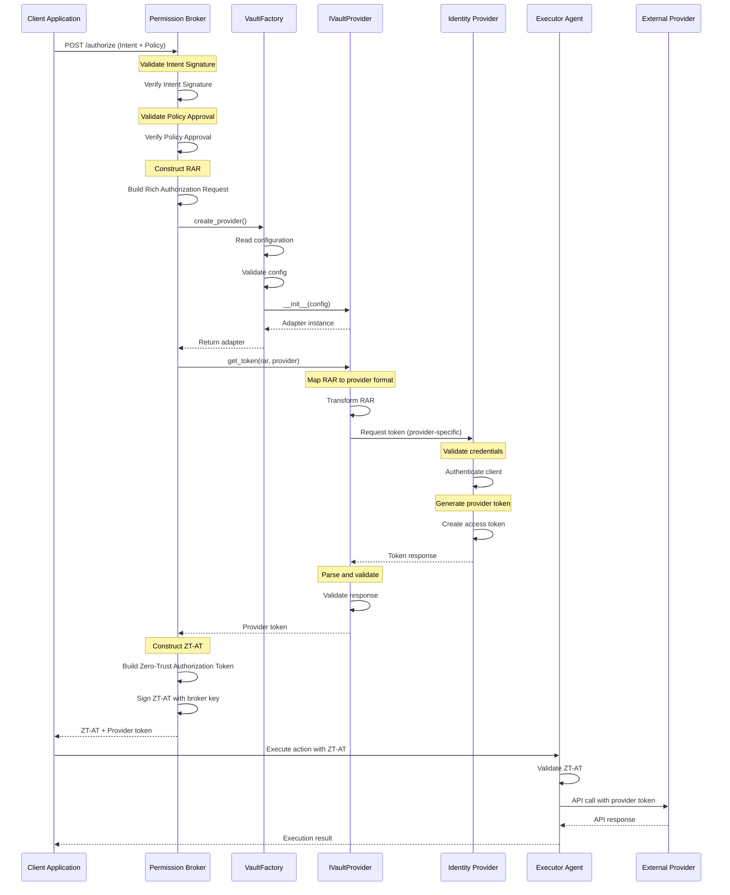
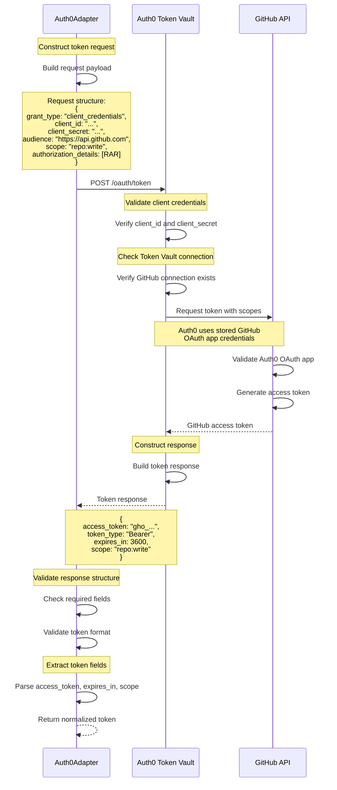
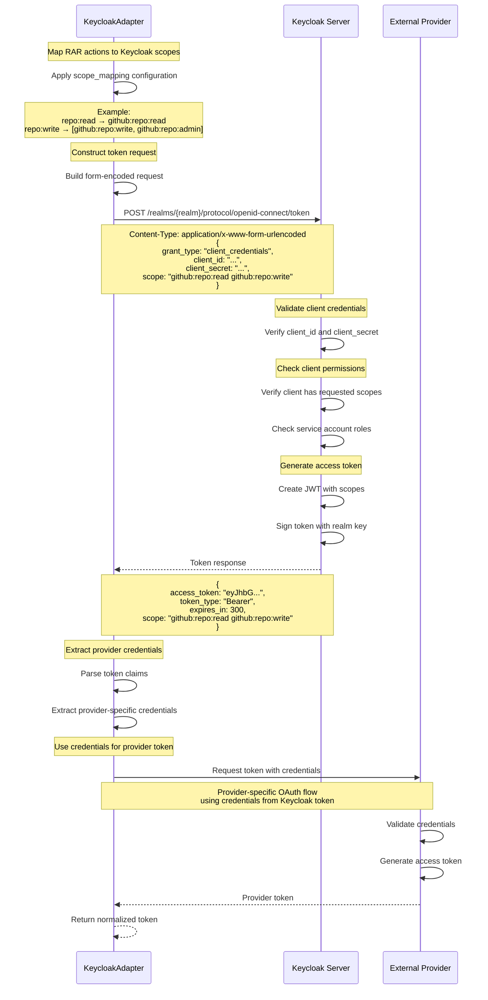
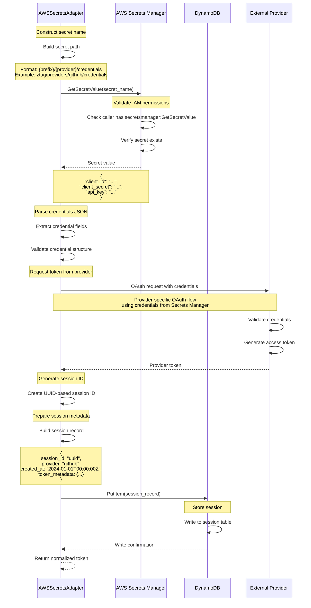
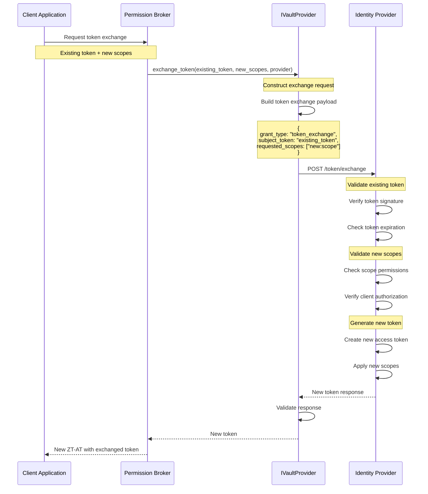
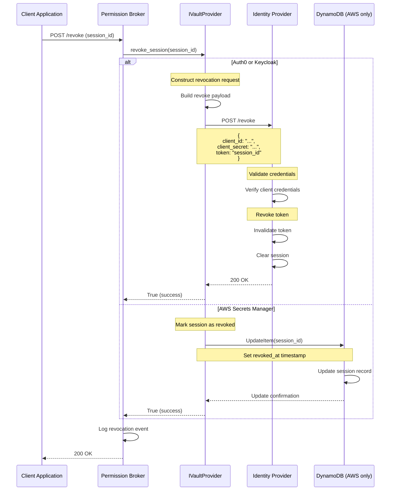
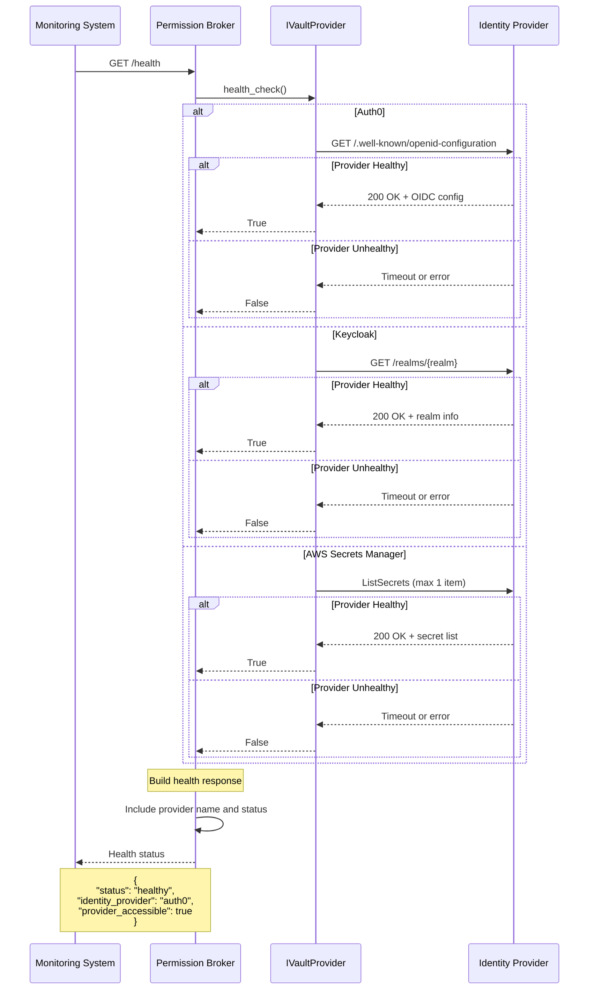
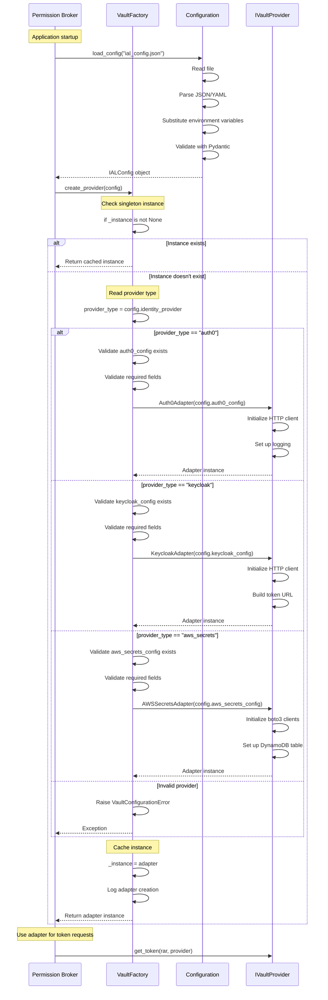
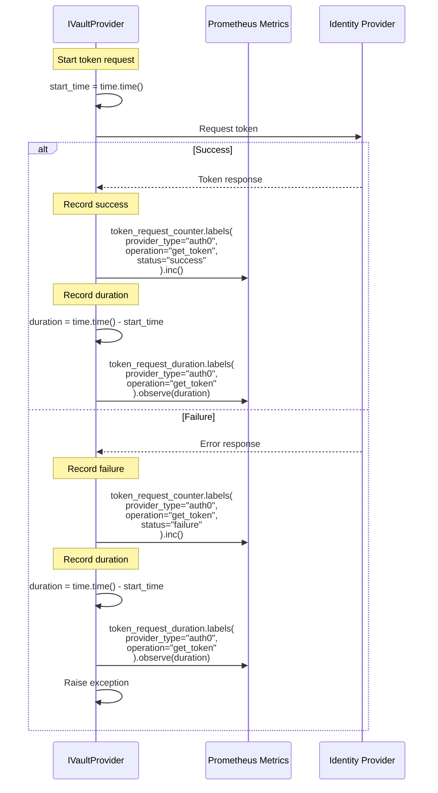

# Identity Abstraction Layer - Sequence Diagrams

## Overview

This document provides detailed sequence diagrams for the Identity Abstraction Layer, illustrating the flow of token requests, exchanges, and revocations across different identity providers.

## Table of Contents

- [Permission Broker Integration Flow](#permission-broker-integration-flow)
- [Auth0 Token Request Flow](#auth0-token-request-flow)
- [Keycloak Token Request Flow](#keycloak-token-request-flow)
- [AWS Secrets Manager Token Request Flow](#aws-secrets-manager-token-request-flow)
- [Token Exchange Flow](#token-exchange-flow)
- [Session Revocation Flow](#session-revocation-flow)
- [Health Check Flow](#health-check-flow)
- [Error Handling Flow](#error-handling-flow)

---

## Permission Broker Integration Flow

This diagram shows the complete authorization flow from the Permission Broker through the IAL to the identity provider.

---

## Auth0 Token Request Flow

Detailed flow for Auth0 Token Vault integration.

---

## Keycloak Token Request Flow

Detailed flow for Keycloak client credentials flow with scope mapping.

---

## AWS Secrets Manager Token Request Flow

Detailed flow for AWS Secrets Manager credential retrieval and session tracking.

---

## Token Exchange Flow

Flow for exchanging an existing token for a new token with different scopes.

---

## Session Revocation Flow

Flow for revoking an active session.

---

## Health Check Flow

Flow for checking identity provider availability.

---

## Error Handling Flow

Flow showing error handling and retry logic.

```mermaid
sequenceDiagram
    participant PB as Permission Broker
    participant Adapter as IVaultProvider
    participant Retry as Retry Decorator
    participant IdP as Identity Provider

    PB->>Adapter: get_token(rar, provider)
    
    Note over Adapter: Retry decorator wraps method
    Adapter->>Retry: Execute with retry logic
    
    loop Retry attempts (max 3)
        Retry->>IdP: POST /token
        
        alt Success (200 OK)
            IdP-->>Retry: Token response
            Retry-->>Adapter: Token data
            Note over Retry: Exit retry loop
        
        else 4xx Client Error
            IdP-->>Retry: 400/401/403/404
            Note over Retry: No retry for client errors
            Retry->>Retry: Raise VaultAuthenticationError or VaultValidationError
            Retry-->>Adapter: Exception
            Note over Retry: Exit retry loop
        
        else 5xx Server Error
            IdP-->>Retry: 500/502/503
            Note over Retry: Retry on server errors
            
            alt Not last attempt
                Retry->>Retry: Calculate backoff delay
                Note over Retry: delay = base * (2 ^ attempt) + jitter<br/>Example: 1s, 2s, 4s
                Retry->>Retry: Sleep(delay)
                Retry->>Retry: Log retry attempt
                Note over Retry: Continue to next attempt
            else Last attempt
                Retry->>Retry: Raise VaultProviderError
                Note over Retry: Include all attempt details
                Retry-->>Adapter: Exception
                Note over Retry: Exit retry loop
            end
        
        else Network Error
            IdP-->>Retry: Connection error / Timeout
            Note over Retry: Retry on network errors
            
            alt Not last attempt
                Retry->>Retry: Calculate backoff delay
                Retry->>Retry: Sleep(delay)
                Retry->>Retry: Log retry attempt
                Note over Retry: Continue to next attempt
            else Last attempt
                Retry->>Retry: Raise VaultProviderError or VaultTimeoutError
                Retry-->>Adapter: Exception
                Note over Retry: Exit retry loop
            end
        end
    end
    
    alt Success
        Adapter-->>PB: Token
        PB->>PB: Construct ZT-AT
        PB-->>PB: Return success
    
    else VaultAuthenticationError
        Adapter-->>PB: VaultAuthenticationError
        PB->>PB: Log error
        PB-->>PB: Return HTTP 401
    
    else VaultValidationError
        Adapter-->>PB: VaultValidationError
        PB->>PB: Log error
        PB-->>PB: Return HTTP 400
    
    else VaultTimeoutError
        Adapter-->>PB: VaultTimeoutError
        PB->>PB: Log error
        PB-->>PB: Return HTTP 504
    
    else VaultProviderError
        Adapter-->>PB: VaultProviderError
        PB->>PB: Log error
        PB-->>PB: Return HTTP 502
    end
```

---

## Factory Instantiation Flow

Flow showing how VaultFactory creates and caches adapter instances.

---

## Metrics Collection Flow

Flow showing how metrics are collected during token operations.

---

## See Also

- [Architecture Documentation](architecture.md) - Design and architecture details
- [Configuration Guide](configuration.md) - Configuration examples
- [API Reference](api-reference.md) - Detailed API documentation
- [Troubleshooting Guide](troubleshooting.md) - Common issues and solutions
